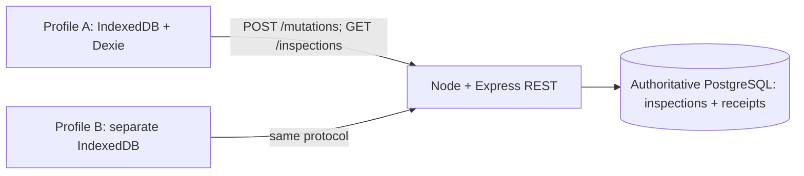

# SyncProof

[Publication notes](PUBLICATION.md)

A local field-inspection demonstration of durable offline intent, revision-checked writes and recovery when a request commits but its acknowledgment disappears. Two independent browser stores edit title/status/notes, preserve conflicts and reconcile against authoritative PostgreSQL.

**Phase7 complete for the measured/tested local scope.** [Final report and A01–A20](docs/PHASE_REPORTS/PHASE_7.md), [engineering handbook](docs/SYNCPROOF_ENGINEERING_HANDBOOK.md), [performance](docs/PERFORMANCE_REPORT.md), [publication review](docs/RELEASE_READINESS.md). This educational implementation is not a replacement for RxDB, Electric or PouchDB/CouchDB and is not a production SaaS service.

## Architecture and scope



Vite serves127.0.0.1:5174 and proxies /api to127.0.0.1:3000. The API owns committed record revisions and immutable terminal receipts; profiles own drafts, frozen requests, unknown outcomes, conflict history and clean observations. Full snapshots retain tombstones. Foreground reconciliation is recover unknown → pull → send queued → pull. No auto merge, restore, cursor/change log, live/background sync, service worker, auth/multitenancy or deployment system. One active controller/tab per profile; two shared-profile tabs are not independent clients.

## Tested prerequisites

Windows11/PowerShell, Node24.15.0 (engines >=24 <25), npm11.12.1, PostgreSQL18.6 UTF8; Playwright1.64.1/Chromium156.0.8078.4. Exact dependencies are pinned in package-lock.json. Other OS/browser versions are not certified. The PowerShell helper expects PostgreSQL18 binaries under its documented Windows path; use its PostgresBin option or your own dedicated UTF8 database if needed.

From the repository root:

```powershell
npm ci --ignore-scripts
npm run build
$env:PLAYWRIGHT_BROWSERS_PATH=(Join-Path (Get-Location) '.local/browsers')
npx playwright install chromium
```

The fresh-copy check verified an independent network-enabled lockfile install with lifecycle scripts disabled, backend/client builds, strict checks,18 contract tests and a real isolated PostgreSQL HTTP smoke. It did not test a remote clone on another machine. [Actual result](docs/evidence/phase-7/fresh-copy.json).

## Start locally

Terminal1 (database + backend):

```powershell
.\scripts\local-postgres.ps1 -Action Start
$env:DATABASE_URL='postgresql://syncproof@127.0.0.1:55432/syncproof_dev'
$env:ALLOWED_ORIGIN='http://127.0.0.1:5174'
$env:PORT='3000'
npm run build
npm run migrate
npm start
```

Terminal2 (frontend):

```powershell
npm run dev:client
```

Open [SyncProof](http://127.0.0.1:5174). The helper creates/starts ONLY a separate project-owned cluster on loopback55432 with synthetic syncproof_dev/syncproof_test databases. It does not change an existing Windows PostgreSQL service. Its trust authentication permits other local processes to connect; never expose it or use sensitive data. For your own database, substitute URLs/credentials privately in environment variables or ignored .env; .env.example contains placeholders, not real credentials. Migrations are transactional/checksum-checked and safe to repeat; they do not reset data.

Terminal3 (two real independent visible Chromium profiles):

```powershell
node scripts/demo-clients.mjs
```

This opens separate persistent profiles under ignored .local/profiles/owner-demo-A and owner-demo-B. Close both windows or Ctrl+C; saved data is retained. Keep the same server database while retaining profiles. A reset/replaced DB with missing known IDs deliberately blocks reconciliation; do not clear profiles or developer data merely to hide that error. The disposable `node scripts/demo-clients.mjs --check` mode was actually verified, closes both processes and removes only its generated check profiles.

## Normal inspection workflow

1. **New inspection** → enter fields → **Save draft**. Only completed saves survive supported restart; unsaved typing does not.
2. **Queue for future sync** freezes a new immutable ID/hash/envelope and locks that record. Queueing is not server acceptance. Other records remain usable.
3. **Send pending / Retry** attempts unknown IDs first, then never-attempted work. Lost/malformed responses retain the original ID. **Reconcile now** also pulls before/after queued sends.
4. Select a conflict. Inspect original common base, rejected local intent, historical receipt and latest known server. **Review latest server** refreshes without auto-sending queued work.
5. **Keep server** needs confirmation and makes a local decision without POST. **Reapply local values** or **Manually combine values** prepares an editable draft against a reviewed LIVE revision. Save edits, review operation/base, explicitly queue/send a NEW ID. **Cancel resolution draft** restores the original conflict.
6. Another writer can cause another conflict. Pending/unknown resolution cannot be edited or replaced. Original evidence remains in operation history.
7. **Delete inspection** requires confirmation and retains a versioned tombstone. Stale delete against newer live state requires a fresh confirmed request; tombstones allow keep deletion only. No implicit undelete, upsert or extra automatic delete.

No automatic startup send or offline shell caching. Offline authoring works after the page loads; the frontend shell must remain reachable after restart. Server acknowledgment and a completed snapshot observation are distinct, neither promises permanent global equality.

## Tests and ordered demonstration

Stop the normal backend/frontend first: tests own3000/5174. Keep the dedicated test database running; never point tests at real user data. Tests create/drop ONLY run-owned generated schemas and disposable browser profiles.

```powershell
$env:TEST_DATABASE_URL='postgresql://syncproof@127.0.0.1:55432/syncproof_test'
# Keep new output separate from earlier milestone evidence:
$env:SYNCPROOF_EVIDENCE_PHASE='phase-7'
$env:SYNCPROOF_AUDIT_RUN_ID=[guid]::NewGuid().ToString()
npm test
npm run test:local
npm run test:push
npm run test:snapshot
npm run test:resolution
npm run test:audit:db
npm run test:browser
npm run typecheck
npm run build:client
```

| Layer | Current executed cases | Evidence |
| --- | --- | --- |
| Backend |45 (18 contract +27 real SQL/process) | [backend.txt](docs/evidence/phase-7/backend.txt) |
| New DB audit |3; test:audit:db runs6 because3 process checks repeat | [audit-db.txt](docs/evidence/phase-7/audit-db.txt) |
| Local / push / snapshot / resolution |13 /9 /4 /5 | [local](docs/evidence/phase-7/local.txt), [push](docs/evidence/phase-7/push.txt), [snapshot](docs/evidence/phase-7/snapshot.txt), [resolution](docs/evidence/phase-7/resolution.txt) |
| Full Chromium |44 (31 prior +11 audit +2 complete demo repetitions) | [browser.txt](docs/evidence/phase-7/browser.txt) |

123 named cases,126 executions across these commands because three process checks repeat. A separate fresh-copy18-unit smoke is not added as new distinct product cases. Builds/typechecks passed. [Current release evidence](docs/evidence/phase-7/release-check.json).

Focused reproduction:

```powershell
npm run test:audit
npm run test:demo
```

Audit builds then runs6 SQL/process and20 browser cases covering F1–F10 plus resolution regressions. Demo runs ONE full eight-step story TWICE from clean fixtures: common revision, A success, B stale conflict, explicit new resolution, different committed/lost reply, same-ID replay, different offline queue surviving actual browser restart, both final clean observations including tombstone. [Ordered trace1](docs/evidence/phase-7/demo-run-1.json), [trace2](docs/evidence/phase-7/demo-run-2.json).

## Scoped reliability claims and exact support

| Claim under stated assumptions | Executed test name(s) / source / actual evidence |
| --- | --- |
| Original outcome survives lost reply and later write | `F1 confirmed commit loss replays original ID before newer snapshot and atomic acknowledgment`, [audit.spec.ts](tests/browser/audit.spec.ts), [F1](docs/evidence/phase-7/F1.json). |
| Duplicate success/conflict ownership and collision | `F2 HTTP concurrent success duplicates arbitrate one receipt and preserve identity` and conflict parameter, [audit.test.ts](tests/audit.test.ts), [success](docs/evidence/phase-7/F2-success.json), [conflict](docs/evidence/phase-7/F2-conflict.json). |
| Delivery/competition does not overwrite stale intent | `F3 HTTP reverse delivery delayed A preserves stale loser` / B and `F8 independent clients both at record-lock barrier then A wins without lost update` / B, [browser audit](tests/browser/audit.spec.ts), [F3-A](docs/evidence/phase-7/F3-A.json), [F8-B](docs/evidence/phase-7/F8-B.json). |
| Partial independent-record cycle retains progress | `F4 independent-record cycle interruption retains acknowledged unknown queued and recovers in order`, [audit](tests/browser/audit.spec.ts), [F4](docs/evidence/phase-7/F4.json). |
| Committed local state survives tested graceful lifecycle | `F5 real graceful Chromium restarts retain saved draft queued unknown locks and completed receipt`, [audit](tests/browser/audit.spec.ts), [F5](docs/evidence/phase-7/F5.json). |
| Application-process failure respects commit boundary | `F6 ACTUAL Node termination/restart at after_record_write_before_commit preserves transaction/replay semantics` and after_commit_before_response parameter, [process.test.ts](tests/process.test.ts), [before](docs/evidence/phase-7/F6-precommit.json), [after](docs/evidence/phase-7/F6-postcommit.json). |
| Interrupted resolution retains original identity | `F9 committed resolution dropped reply, newer write and graceful browser restart replay same ID`, [resolution.spec.ts](tests/browser/resolution.spec.ts), [F9](docs/evidence/phase-7/F9.json). |
| Tombstones and simulated offline recovery preserve safety | `F7 lost stale update receipt replays historical conflict and never revives tombstone` / delete, `F10 simulated 21 days offline recovers unknown before tombstones and preserves stale intent until explicit decision`, [audit](tests/browser/audit.spec.ts), [F7](docs/evidence/phase-7/F7-update.json), [F10](docs/evidence/phase-7/F10.json). |
| Full snapshot validation/install is monotone/atomic | `native snapshot transaction abort and HTTP outage preserve all local state and retry recovers` plus delayed/missing-row cases, [snapshot.spec.ts](tests/browser/snapshot.spec.ts), [full output](docs/evidence/phase-7/browser.txt). |

These finite schedules are not formal proofs, exactly-once delivery, unconditional convergence or universally lossless storage. Eventual reconciliation needs retained functioning stores, reachable foreground opportunities, finite/quiescent writes and explicit conflict decisions. Eviction/profile deletion, OS/power/disk/database-process failure, forced browser kill, competing tabs, incompatible DB restore, untrusted public deployment and multi-region are unsupported/unverified. Simulated21 days is NOT physical weeks of browser storage survival. Real Node forced termination is distinct from graceful Chromium restart and injected storage exceptions.

## Performance and readiness checks

```powershell
node scripts/bench.mjs --smoke --seed=20261105
node scripts/bench.mjs --seed=20261105
node scripts/reproduce.mjs --online
npm audit --json
node scripts/release-audit.mjs
```

Run benchmarks with no tests/app occupying3000/5174; build first. The two-repetition bounded matrix measures HTTP accepted/replay/conflict, writers1/2/10/20, N100/500/1000 snapshots/real browser install, Q10/50/100 pending/foreground recovery and SQL retained growth. Fresh schemas/contexts are cleaned; no user tables/profiles are cleared. [Method/boundaries/actual summary](docs/PERFORMANCE_REPORT.md), [raw4010 samples](docs/evidence/phase-7/bench-raw.json). They are warm localhost observations, not capacity/SLAs or correctness proof. No benchmark framework/dependency or product optimization was added.

This source publication retains the local educational scope. No project license has been selected. Historical local user-directory prefixes have been redacted in this publication copy; see [publication notes](PUBLICATION.md). [Full audit/checklist](docs/RELEASE_READINESS.md), [dependency inventory](docs/evidence/phase-7/dependency-licenses.json). The linked Phase 7 reports describe the earlier pre-publication audit; they are historical evidence, not the current GitHub publication status. Optional screenshots/video were not produced; no generated image is represented as real UI.

At the end of a local session:

```powershell
.\scripts\local-postgres.ps1 -Action Stop
```

This stops only the helper's owned cluster. It does not delete databases or browser profiles.

## Reading order

Start with this guide, then [handbook chapters1–9](docs/SYNCPROOF_ENGINEERING_HANDBOOK.md), [protocol](docs/PROTOCOL_SPEC.md), [invariants](docs/INVARIANTS_AND_FAILURE_MATRIX.md), [evidence register](docs/ENGINEERING_EVIDENCE_REGISTER.md), [performance](docs/PERFORMANCE_REPORT.md), [readiness](docs/RELEASE_READINESS.md) and [Phase7 report](docs/PHASE_REPORTS/PHASE_7.md). Earlier reports/evidence remain historical. Independent exercises are not completed on your behalf.

**Scope:** Source publication does not deploy the application or change its loopback-only trust model.
