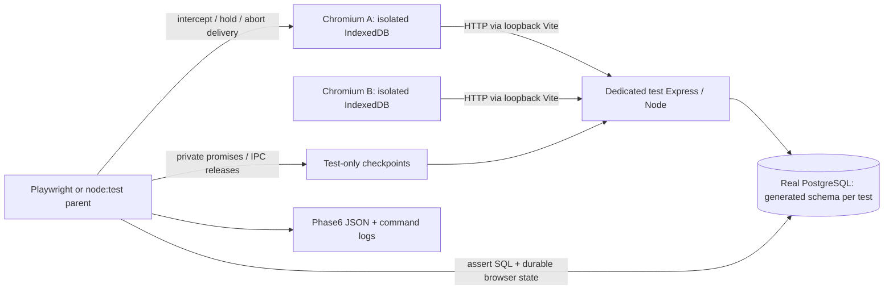

# Phase 6 engineering report

2026-11-04, Asia/Calcutta. **PHASE 6 COMPLETE for the specified bounded scenarios.** A01–A22 PASS; ready for owner review of the Phase7 gate. No Phase7 work, benchmark, deployment or publication was started. This is executed evidence, not formal verification, exactly-once delivery or unconditional convergence.

## Alignment before edits

Inspected current README/STATUS, package/lock/config/environment example, charter/protocol/invariants/roadmap/decisions/evidence and Phase0–5 reports; actual contracts, mutation/read server, db/migration, client contract/storage/push/pull/conflict/UI; integration/process/local/browser helpers and owned PostgreSQL scripts. No applicable workspace AGENTS.md was found. Retained Phase5 logs showed45 backend,13 local,9 push,4 snapshot,5 resolution and31 browser cases (107 total), matching its artifact audit. These were prior observations, not assumed current passes; all relevant suites reran below.

Available commands before changes: npm test (build,18 contract+27 real DB/process), test:local13, test:push9, test:snapshot4, test:resolution5, test:browser31, typecheck/check:client/build/build:client. Strong prior F1/F2/F4/F5/F6/F7/F9 layers existed, but F3 before-HTTP-admission ordering, coordinated F8 browser race, full scenario consolidation and one complete ordered demo remained unrun. Earlier source/log inspection is distinct from final execution. No fundamental protocol contradiction was found.

Protocol1 POST /mutations retains immutable UUID/client/record/operation/base/payload, canonical ordered UTF8 JSON and SHA-256; revision strings are positive decimal BIGINT. A valid success/conflict is a lifetime durable original terminal receipt; changed content under the same ID collides. Deletes retain revisioned tombstones. GET /inspections is a complete single-statement snapshot, including tombstones. Dexie v1 work/mutations/cleanRecords/metadata keeps mutable drafts separate from immutable frozen/unknown attempts and historical receipts. One outstanding mutation per record/profile, one controller per profile. Unknown before POST, same-ID recovery before pull, normal recover→pull→push→pull, monotone clean state and explicit new-ID conflict resolution remain unchanged.

Stable invariants audited: INV-ACK-01, INV-ATOMIC-01, INV-IDEMP-01, INV-REV-01, INV-DRAFT-01, INV-ACKCLIENT-01, INV-UNKNOWN-01, INV-CONFLICT-01, INV-TOMB-01, INV-SNAP-01, INV-ONE-01, INV-RECON-01. All ten original F-row definitions were mapped before coding. Their seven-facet current mapping and exact test names are retained in [audit-summary.json](../evidence/phase-6/audit-summary.json). Initial planned scope was test-only helpers/scenarios/evidence plus npm/docs; production changes only if an executed failing test justified them. None was needed.

## Exact file inventory and production boundary

Paths resolve under `<USER_HOME>/OneDrive/Documents/ChatGPT/SYNCPROOF`.

| File | Bounded change |
| --- | --- |
| [tests/audit-evidence.ts](../../tests/audit-evidence.ts) | New shared JSON capture after successful assertions; scenario/run identity and timestamp, no credentials. |
| [tests/audit.test.ts](../../tests/audit.test.ts) | New real HTTP success/conflict duplicate arbitration/collision and normal-runtime fault-route/header negative tests. |
| [tests/browser/audit-harness.ts](../../tests/browser/audit-harness.ts) | New isolated schema/server/client/profile fixtures, actual PID capture, explicit checkpoint and response gates, durable-state/SQL assertions, contained cleanup. |
| [tests/browser/audit.spec.ts](../../tests/browser/audit.spec.ts) | Eleven cases filling/consolidating F1/F3/F4/F5/F7/F8/F10 and native pre-send marker abort. |
| [tests/browser/demo.spec.ts](../../tests/browser/demo.spec.ts) | One ordered eight-step story, parameterized as two clean-fixture repetitions. |
| [tests/process.test.ts](../../tests/process.test.ts) | Reuse existing real child-process launcher/checkpoints; extend both F6 cases with local unknown/lock/receipt assertions and current machine evidence. Local storage is explicitly fake-indexeddb here. |
| [tests/browser/resolution.spec.ts](../../tests/browser/resolution.spec.ts) | Existing strong F9 case reused, adding rich Phase6 evidence capture; original test semantics retained. |
| [scripts/verify-audit.mjs](../../scripts/verify-audit.mjs) | Verify fresh matching-run artifacts, logs/counts, two equivalent ordered traces, source hashes, real PIDs and schema cleanup; no synthetic correctness result generation. |
| [package.json](../../package.json) | Add test:audit:db, test:audit:browser, test:audit and test:demo scripts; no dependency change. |
| [README](../../README.md), [STATUS](../../STATUS.md), [roadmap](../ROADMAP.md) | Reproduction commands, honest current scope and stop gate; roadmap status paragraph only. |
| [Failure matrix](../INVARIANTS_AND_FAILURE_MATRIX.md), [evidence register](../ENGINEERING_EVIDENCE_REGISTER.md) | Scoped current F1–F10/C01–C19/demo evidence; stable invariant IDs, prior milestone history preserved. |
| [This report](PHASE_6.md) | Actual observations, full acceptance, limitations/Q&A/exercise. |
| docs/evidence/phase-6/ | Exact generated artifact inventory below. |

**No production-source edit or correctness fix.** Server/client application source, API contracts, migration, dependency lockfile, Vite/Playwright/TypeScript configs and PostgreSQL helper match baseline SHA-256. Protocol specification and decision log did not need a contract change and remain unchanged. Source audit finds only package.json, process.test.ts and resolution.spec.ts modified among pre-existing source/config files; all other new code is test/harness/evidence. No broad refactor or test deletion. There is no HEAD commit; source hashes identify this uncommitted workspace.

Existing regressions automatically refresh four prior fixed-path JSON artifacts: phase-2/browser-lifecycle.json, phase-3/f1-observation.json, phase-3/browser-recovery.json and phase-5/f9.json. Their original values were copied to phase-6/before-*.json BEFORE testing. Prior logs and reports were not rewritten. New JSON contains actual IDs/canonical payloads using synthetic data, not database URLs/secrets. Latest outputs are overwritten on a rerun; archive the evidence directory if another audit must be preserved.

## Fault architecture and safety

Browser fixtures create only random syncproof_audit_* schemas in the dedicated test DB, use the compiled unchanged server on127.0.0.1:3000, and own fresh contexts or persistent directories under ignored .local/profiles. Earlier tests keep their existing syncproof_test_*/syncproof_push_* isolation. Full browser execution is one worker; port5174 belongs to Vite. Ordinary app startup has no seed/fault endpoint. Local database helper touches only the project-owned cluster on55432, never the existing Windows PostgreSQL service.

Programmatic mutation hooks already existed; only a test fixture passes them to createApp. Deployed/normal server code accepts no HTTP crash controls. Existing child-process hooks activate only with SYNCPROOF_TEST_PROCESS=1, NODE_ENV=test AND parent IPC; the negative test confirms refusal with production mode or missing IPC. New negative HTTP test gets404 for crash/checkpoint/fault paths; a test-looking request header cannot activate a hook. No new normal-runtime fault switch was added.

Promises/SQL observations select the schedule: held claim owner and pg_blocking_pids for F2; before-admission route gates for F3; real before_record_lock hooks for F8; private parent checkpoints for actual Node termination. Browser response-loss helpers confirm SQL receipt after actual backend commit and hold delivery until reload destroys the prior controller, then abort the intercepted route. This removes dependence on a retry-backoff race in F4. Timeout deadlines only fail hung operations; no arbitrary sleep selects a winner. Existing bounded production retries remain unchanged.

Fixture try/finally releases held gates, closes only owned contexts/servers/pools and drops only generated regex-validated schema names. Persistent directory removal verifies absolute containment under .local/profiles and follows browser close. The existing Node launcher awaits real exit/readiness and kills only its owned child. Final verification found zero generated test schemas and no remaining audit profile directories. Test-run JSON is written after assertions; the verifier rejects stale run IDs and checks actual retained command logs, so old PASS files cannot substitute for a failed final run.

## F1–F10 actual scenario matrix

Each expected state below was asserted and observed PASS. The [machine index](../evidence/phase-6/audit-summary.json) separately records all seven facets: initial state, operations/fault, expected client, expected server, recovery, invariants/evidence and limitations. Actual detailed durable objects/IDs/outcomes are in each linked artifact. Earlier partial layers were not relabeled as real process/network modalities they never exercised.

| ID / fixture and operation / fault | Expected and actual client/server | Recovery | Exact test names/path and actual layer | Invariants / result / limit |
| --- | --- | --- | --- | --- |
| F1: Live1, update/base1. SQL-confirmed commit2 reply held; reload destroys old controller before delivery. | Unknown ID/hash/envelope/lock retained; one receipt. Replay gives original2, pull gives clean3; no draft/work remains. | Original ID first, then full pull; native acknowledgment abort also reruns. | `F1 confirmed commit loss replays original ID before newer snapshot and atomic acknowledgment` [Source](../../tests/browser/audit.spec.ts); Real PostgreSQL/Chromium + simulated HTTP loss. [F1.json](../evidence/phase-6/F1.json) | INV-ACK-01, INV-ATOMIC-01, INV-IDEMP-01, INV-UNKNOWN-01, INV-ACKCLIENT-01. **PASS**. Interception/reload; local ack abort additionally covered in resolution/browser regressions |
| F2: Live1 success candidate or live2 stale candidate. Hold claim owner; observe distinct waiter backend actually blocked; release. Sequential duplicate and changed-content collision too. | One target receipt, identical original success/conflict replay, unchanged final2 after duplicates/collision. Owner rollback/takeover passes in prior integration suite. | Wait/replay exact bytes; collision rejects without re-ID. | `F2 HTTP concurrent success duplicates arbitrate one receipt and preserve identity` `F2 HTTP concurrent conflict duplicates arbitrate one receipt and preserve identity` [Source](../../tests/audit.test.ts); Real PostgreSQL + concurrent independent HTTP connections. [F2-success.json](../evidence/phase-6/F2-success.json), [F2-conflict.json](../evidence/phase-6/F2-conflict.json) | INV-IDEMP-01, INV-ATOMIC-01, INV-REV-01. **PASS**. HTTP clients plus existing browser collision regression; no exactly-once delivery claim |
| F3: Both isolated browsers at1, distinct IDs/base1. Send delayed client first; hold before HTTP admission until the other commits. Both A/B delayed variants. | Delivered-first wins2; loser terminal conflict preserves base1/local/canonical and own receipt; no lost update. | Explicit keep-server; both clean caches equal current2. | `F3 HTTP reverse delivery delayed A preserves stale loser` `F3 HTTP reverse delivery delayed B preserves stale loser` [Source](../../tests/browser/audit.spec.ts); Real Chromium/HTTP/PostgreSQL, controlled route release. [F3-A.json](../evidence/phase-6/F3-A.json), [F3-B.json](../evidence/phase-6/F3-B.json) | INV-REV-01, INV-CONFLICT-01, INV-IDEMP-01. **PASS**. Controlled finite orderings; no general network ordering guarantee |
| F4: Three independent queued creates. Acknowledgment1 delivered, commit2 response held until reload, third unattempted. | Exactly acknowledged/unknown/queued locally; two server rows/receipts before recovery, three afterward; each final revision1. | Replay unknown first, pull, send remaining queued, final pull. Existing malformed/native snapshot-abort regressions pass. | `F4 independent-record cycle interruption retains acknowledged unknown queued and recovers in order` [Source](../../tests/browser/audit.spec.ts); Real Chromium/PostgreSQL; simulated delivery interruption/controller reload. [F4.json](../evidence/phase-6/F4.json) | INV-ATOMIC-01, INV-UNKNOWN-01, INV-ACKCLIENT-01, INV-ONE-01, INV-SNAP-01, INV-RECON-01. **PASS**. No multi-record atomicity; snapshot abort/truncation covered by existing snapshot suite |
| F5: API gate disconnected. Saved draft and distinct queued create; later committed-unknown create; whole browser close/relaunch. | Exact durable identity/work/envelope/hash/lock retained; fresh profile empty; unknown replayed; draft retained and completed receipt survives another reopen. | Four actual distinct Chromium PIDs, same profile; reconnect/send/reconcile. | `F5 real graceful Chromium restarts retain saved draft queued unknown locks and completed receipt` [Source](../../tests/browser/audit.spec.ts); Real IndexedDB + graceful Chromium processes/PostgreSQL. [F5.json](../evidence/phase-6/F5.json) | INV-DRAFT-01, INV-ONE-01, INV-UNKNOWN-01, INV-ACKCLIENT-01. **PASS**. Graceful only, reachable frontend shell, no eviction/forced browser kill/power loss |
| F6: Create marked unknown; no initial record/receipt. Kill dedicated Node at provisional-write-before-commit and commit-before-reply checkpoints. | Before kill 0/0 or1/1 as expected. Lost HTTP result and unknown retained; new PID retry yields record1/one receipt in both variants. | Precommit executes once (replayed=false); postcommit returns original (true); atomic local acknowledgment. | `F6 ACTUAL Node termination/restart at after_record_write_before_commit preserves transaction/replay semantics` `F6 ACTUAL Node termination/restart at after_commit_before_response preserves transaction/replay semantics` [Source](../../tests/process.test.ts); Actual forced Node OS process exit; real PostgreSQL; local store explicitly fake-indexeddb. [F6-precommit.json](../evidence/phase-6/F6-precommit.json), [F6-postcommit.json](../evidence/phase-6/F6-postcommit.json) | INV-ACK-01, INV-ATOMIC-01, INV-IDEMP-01, INV-UNKNOWN-01. **PASS**. Actual Node termination; local store fake-indexeddb, separate actual-browser coverage; PostgreSQL remains running |
| F7: Browser update/delete/base1 after remote2. Durable conflict2 reply lost; server later3 then tombstone4. | Original base/proposal/receipt2 remain; separate clean3/4. Stale create/update/delete against tombstone all409; row stays deleted4. | Same-ID original conflict replay, full pull, confirmed keep deletion. | `F7 lost stale update receipt replays historical conflict and never revives tombstone` `F7 lost stale delete receipt replays historical conflict and never revives tombstone` [Source](../../tests/browser/audit.spec.ts); Real Chromium/PostgreSQL + simulated conflict-response loss. [F7-update.json](../evidence/phase-6/F7-update.json), [F7-delete.json](../evidence/phase-6/F7-delete.json) | INV-REV-01, INV-CONFLICT-01, INV-IDEMP-01, INV-UNKNOWN-01, INV-TOMB-01. **PASS**. Receipt/tombstone retention within unpruned test DB, no restore coverage |
| F8: Two independent browser client IDs/base1; both transactions arrive before_record_lock. Release A-first/B-first in separate cases. | One success2 and one visible preserved conflict with separate receipts. New explicit resolution/base2 commits3; both clean caches3. | Reconcile loser without dropping work; deliberately reapply/newID; final pulls. Second-conflict race regression also passes. | `F8 independent clients both at record-lock barrier then A wins without lost update` `F8 independent clients both at record-lock barrier then B wins without lost update` [Source](../../tests/browser/audit.spec.ts); Real independent browser stores + PostgreSQL transaction barriers. [F8-A.json](../evidence/phase-6/F8-A.json), [F8-B.json](../evidence/phase-6/F8-B.json) | INV-REV-01, INV-CONFLICT-01, INV-RECON-01. **PASS**. One controller per independent store; no shared-profile tab arbitration |
| F9: Genuine rejected base4 at remote5; explicit new resolution/base5 commits6; SQL confirms receipt before response loss. | Unknown original resolution ID/hash/envelope/lock and predecessor survive new browser process; one effect/receipt6, latest clean7 after replay. | Same-ID replay before pull; writer7 intervenes; native acknowledgment-abort case also passes. | `F9 committed resolution dropped reply, newer write and graceful browser restart replay same ID` [Source](../../tests/browser/resolution.spec.ts); Real PostgreSQL/HTTP + graceful whole Chromium restart. [F9.json](../evidence/phase-6/F9.json) | INV-IDEMP-01, INV-UNKNOWN-01, INV-ACKCLIENT-01, INV-CONFLICT-01, INV-ONE-01. **PASS**. Graceful browser restart, no forced browser kill or power loss |
| F10: Independent old-base queued record and previously committed unknown create. API disconnected, wall clock advanced21 days; server updates/deletes. | Unknown replay first; complete pull retains tombstones3/2; stale queued proposal becomes preserved conflict, never resurrection; both caches equal after explicit keep. | Restore API, recover/pull/push/pull, confirm keep deletion, final pulls on both clients. | `F10 simulated 21 days offline recovers unknown before tombstones and preserves stale intent until explicit decision` [Source](../../tests/browser/audit.spec.ts); Real PostgreSQL/isolated Chromium stores + simulated time/API disconnection. [F10.json](../evidence/phase-6/F10.json) | INV-TOMB-01, INV-DRAFT-01, INV-UNKNOWN-01, INV-CONFLICT-01, INV-SNAP-01, INV-RECON-01. **PASS**. Simulated duration only; independent not-before fixture schedules queued work, no cursor/aging claim |

Earlier partial F overlays and original supplemental tests remain historical. This phase executes the specified bounded F1–F10 variants, not every imaginable fault modality. Required regressions additionally cover malformed/partial/delayed snapshots, missing known tombstones, native snapshot installation abort, atomic freeze/ack failure, canceled decisions, second conflicts and shared-controller overlap. The new pre-send native IndexedDB marker abort confirms zero transport calls, original queued bytes and no receipt before successful recovery ([evidence](../evidence/phase-6/pre-send-abort.json)). These are injected exceptions, not physical storage failures.

## Real process lifecycle evidence

F6 precommit: Node PID35128→35404, checkpoint `after_record_write_before_commit`, backend PID32772; no committed row/receipt before kill, same-ID retry executes once (`replayed=false`). Postcommit: Node PID35960→2732, checkpoint `after_commit_before_response`, backend PID36092; row1/one receipt before kill, same-ID retry replays (`true`). Parent observes actual exit reported as SIGKILL. On Windows this uses Node child.kill('SIGKILL') to force termination; it is not a graceful server shutdown. PostgreSQL remains running. Local durable-state assertions in this test use fake-indexeddb, stated separately from browser evidence. Both cases also reran in npm test; the JSON retains the later audit invocation.

F5 graceful Chromium launches: PIDs[39888, 25696, 32844, 29012]. Saved draft/queued state survives first reopen; actual unknown survives another; completed acknowledgment survives final reopen. Same profile/origin and exact durable equality are checked; a new isolated profile starts empty. F9 graceful PIDs[12576, 12868]: original resolution commit6/reply loss, unknown original identity survives, legitimate writer7, replayed outcome6 followed by clean7. [F5](../evidence/phase-6/F5.json), [F9](../evidence/phase-6/F9.json). No forced Chromium kill, OS/power crash, eviction or physical-week durability was executed.

## Ordered eight-step demo and reproducibility

Run `npm run build` then `npm run test:demo` with the configured test database/Chromium. demo.spec.ts runs the SAME complete story twice under fresh schemas/profiles; this was executed standalone (2 PASS), then again inside the final44-browser suite (2 PASS, not added again to unique counts). Final matching-run traces: [run1](../evidence/phase-6/demo-run-1.json), [run2](../evidence/phase-6/demo-run-2.json). Each step asserts PostgreSQL receipt identity/count/revision, relevant IndexedDB state and visible status/lock; each then captures both durable clients and SQL rows.

1. Separate persistent A/B profiles/client IDs pull seeded revision1 and see the record; one seed receipt.
2. A UI edit/newID/base1 commits2; A acknowledges and releases work; one mutation receipt.
3. B retained base1/newID conflicts against2; original base/proposal/terminal receipt preserved; server stays2.
4. B explicitly reviews/reapplies/newID/base2, queues/sends and commits3. Both reconcile to B's chosen values; original conflict remains historical.
5. A separate create really commits1 with one SQL receipt while its HTTP delivery is held/lost. Browser remains unknown with original lock/identity.
6. Same-ID replay returns identical original outcome; no extra effect/receipt; local acknowledgment persists. B also observes the record.
7. A different independent offline create is queued but unsubmitted. Whole Chromium closes; same profile opens in a new process with exact client identity/envelope/hash/queue lock and zero server receipt. Form lock visible.
8. B explicitly deletes the response-loss record to retained tombstone2. Restored A/B reconciliation sends remaining queued create once. Both have identical complete three-row clean state: main record3, deleted loss record2, offline-created record1; no active work. Exactly seven server receipts.

Final demo PID evidence: run1 A[16692, 34708], B[24944]; run2 A[44172, 23048], B[13124]. The evidence verifier confirms both traces have ordered steps1–8, seven receipts, three rows, distinct restart PIDs and equivalent logical final state. IDs differ because fixtures are independently generated. This is one interview story repeated twice, not eight independent tests pieced together.

## Actual commands, counts, first failures and audit procedure

Project-owned PostgreSQL was started with `.\scripts\local-postgres.ps1 -Action Start`, synthetic database syncproof_test on127.0.0.1:55432. TEST_DATABASE_URL never enters a browser. A single final run identity is saved in run-context.json and passed via SYNCPROOF_AUDIT_RUN_ID to both Node and Playwright. Browser tests use the installed ignored Chromium and require unused loopback ports3000/5174. Existing npm scripts/configuration were not arbitrarily reconfigured.

Executed initial commands: npm run build; npm run check:client (initial helper compile failure then corrected PASS); npm run test:audit:db (6 PASS); npm run test:audit:browser (then11 new cases PASS); npm run test:demo (2 PASS); later client checks PASS. Current test:audit:browser also includes9 existing resolution cases, giving20; the full final browser run includes them all.

Final retained command outputs:

| Actual command | Result / artifact |
| --- | --- |
| `npm test` | 45 PASS (18 contract+27 PostgreSQL/process), root build included; [backend-final.txt](../evidence/phase-6/backend-final.txt). |
| `npm run test:audit:db` | 6 PASS:3 new DB/safety plus3 existing enhanced process checks; [db-final.txt](../evidence/phase-6/db-final.txt). |
| `npm run test:local` | 13 PASS; [local-final.txt](../evidence/phase-6/local-final.txt). |
| `npm run test:push` | 9 PASS; [push-final.txt](../evidence/phase-6/push-final.txt). |
| `npm run test:snapshot` | 4 PASS; [snapshot-final.txt](../evidence/phase-6/snapshot-final.txt). |
| `npm run test:resolution` | 5 PASS; [resolution-final.txt](../evidence/phase-6/resolution-final.txt). |
| `npm run test:browser` | 44 PASS (31 prior +11 audit +2 ordered demo repetitions); [browser-final.txt](../evidence/phase-6/browser-final.txt). |
| `npm run typecheck` | PASS; [typecheck-final.txt](../evidence/phase-6/typecheck-final.txt). |
| `npm run build:client` | Strict client/browser TypeScript check and Vite build PASS; [build-final.txt](../evidence/phase-6/build-final.txt). |
| `node scripts/verify-audit.mjs` | PASS: fresh artifacts,10 scenario mappings,2 equivalent demos, unchanged production/deps, zero generated schemas; [verification-final.txt](../evidence/phase-6/verification-final.txt). |
| Local documentation consistency check | PASS; [documentation-check.json](../evidence/phase-6/documentation-check.json). |

123 named test cases =45 existing backend +3 new DB audit +13 local +9 push +4 snapshot +5 resolution +44 browser. Final commands execute126 because the3 process checks rerun in test:audit:db; those are not counted twice as distinct cases. Earlier successful attempts and standalone demo runs are also not added again. Zero final failed, skipped, canceled or blocked required cases. The current `npm run test:audit` composite (build→DB/process→20 browser cases) is a reproduction convenience; its components and all included tests were executed, rather than claiming a separately captured composite invocation.

First development failure: TypeScript TS2345/TS2554 in the new test gate helper inferred unknown where a void release function was required. Corrected `ReturnType<typeof gate<void>>`; subsequent checks passed. It was observed before raw log capture, so development-notes.md preserves the diagnostic honestly, not a fabricated raw output. No failing production test or correctness defect was found. Harness review additionally replaced a reload-before-backoff timing window with a held-response/unload barrier; final regressions exercise the stronger schedule. [Development notes](../evidence/phase-6/development-notes.md), initial DB/browser/demo outputs remain retained.

To reproduce the exact evidence-consistency stage after capturing complete final logs, keep the same explicit run ID in all shells. Before running tests write `{"runId":"YOUR-RUN-ID","date":"YYYY-MM-DD","timezone":"Asia/Calcutta"}` to docs/evidence/phase-6/run-context.json; set SYNCPROOF_AUDIT_RUN_ID to that value. Tee commands to the filenames above, then run the verifier while PostgreSQL is available. It validates rather than creates observations; missing/failing/stale artifacts reject. Source baseline is baseline-source.json; changes to audited source require a fresh reviewed baseline rather than silently relaxing the comparison.

Environment and SHA-256: [audit-summary.json](../evidence/phase-6/audit-summary.json). Windows11 x64, Node24.15.0, PostgreSQL18.6 UTF8/READ COMMITTED with fsync/synchronous_commit/full_page_writes on, Chromium156.0.8078.4, Playwright1.64.1, TypeScript7.0.2, Dexie4.4.7. The owned cluster is stopped after final verification; existing Windows PostgreSQL service is untouched. No benchmark or physical failure was run.

Evidence artifact inventory: `F1.json`, `F10.json`, `F2-conflict.json`, `F2-success.json`, `F3-A.json`, `F3-B.json`, `F4.json`, `F5.json`, `F6-postcommit.json`, `F6-precommit.json`, `F7-delete.json`, `F7-update.json`, `F8-A.json`, `F8-B.json`, `F9.json`, `audit-summary.json`, `backend-final.txt`, `baseline-source.json`, `before-browser-lifecycle.json`, `before-browser-recovery.json`, `before-f1-observation.json`, `before-f9.json`, `browser-attempt-1.txt`, `browser-final.txt`, `build-final.txt`, `client-check-attempt-1.txt`, `client-check-demo.txt`, `db-attempt-1.txt`, `db-final.txt`, `demo-attempt-1.txt`, `demo-run-1.json`, `demo-run-2.json`, `development-notes.md`, `documentation-check.json`, `fault-safety.json`, `local-final.txt`, `pre-send-abort.json`, `push-final.txt`, `resolution-final.txt`, `run-context.json`, `snapshot-final.txt`, `typecheck-final.txt`, `verification-final.txt`.

## Complexity, tradeoffs and unsupported cases

Harness work is proportional to the bounded number of fixture records, queued operations, captured durable states and controlled attempts. Each test creates/migrates/drops a small isolated schema; real process startup and browser-profile lifecycle have overhead, but no timing/throughput comparison was measured. Gate maps use keyed lookup; PostgreSQL lock polling yields to I/O and observes actual blockers, never selects a schedule by elapsed sleep. Evidence copies whole bounded client/server snapshots per demo step, so retained trace bytes scale with steps×captured state/payload. New traces are useful for this small educational demo, not a general-purpose chaos platform.

Actual product full snapshot transfer/materialization remains O(N) records plus bytes, local validation/maps O(N+known rows) and indexed installation costs. Candidate validation/canonical hashing remains O(B); retained receipts/tombstones/history grow with lifetime. No pruning, cursor, optimization, capacity limit or benchmark result is introduced. One worker and per-test schemas simplify deterministic evidence at process/setup cost.

Unsupported/unverified: browser eviction/clearing/profile deletion/private-store loss; forced browser kill; disk corruption/hardware/OS/power/database-process failure; physical multiweek storage durability; backup restore/database incarnation changes; competing tabs/controllers; unrestricted production/auth/multitenancy/multi-region; arbitrary permanent partitions and universal fairness. Frontend shell stays reachable after restart; no service worker or cold-load-offline promise. Unauthenticated loopback/synthetic-data demonstration only. Finite observed schedules and conditional clean equality are not formal verification, production readiness, exactly-once delivery or unconditional conflict-free convergence. No new protocol, restoration, auto merge, background sync, architecture, Phase7 optimization/benchmark/publication or educational handbook.

## Interview Q&A and independent owner exercise

1. Why observe SQL before dropping a response? A timeout alone cannot distinguish no admission from a durable commit; the receipt/row proves the intended boundary.
2. Why hold the response through controller reload? It deterministically stops the cycle without racing a retry timer or allowing a later independent queued record to start.
3. What selects the duplicate winner? PostgreSQL's unique receipt claim; the observed waiting backend proves actual competing transactions, not two sequential calls.
4. Why duplicate a conflict too? Conflicts are durable original terminal decisions and must replay their historical observation even after later writes.
5. Why test both request orderings? Distinct same-base writers must obey revision checks regardless of delivery order; the chosen winner should switch.
6. What does F6 establish? Actual application-process failure before/after commit with retained PostgreSQL; it does not establish PostgreSQL-process, OS or power-failure recovery.
7. Why retain unknown identity before pulling? A newer record or tombstone may follow a successful unacknowledged mutation; only its original receipt identifies its outcome.
8. What does the browser restart prove? Exact committed data survives the tested graceful same-profile lifecycle; eviction/forced termination/physical long-term storage are separate.
9. Why is final equality conditional? It requires quiescent writes, reachable recovery opportunities, working retained storage and human conflict decisions.
10. Why source hashes and run IDs? They tie current observations to audited source and prevent stale PASS files being mistaken for the final execution.

**Owner-independent coding/testing exercise — NOT completed for the owner:** Create tests/browser/owner-exercise.spec.ts yourself, importing the audit fixture. Seed one record; both clients pull1. Hold A's mutation response after real commit2. Have B commit3, then a tombstone4, before A recovers. Assert A retries the original ID and stores original success2 while clean state becomes tombstone4. Add an unsent A draft on a different record; prove the same cycle preserves it. Inject an invalid supposedly complete snapshot missing the known tombstone, verify whole-state rollback and no new completed-pull metadata. Use explicit gates, real SQL checks, durable IndexedDB assertions and try/finally cleanup. Explain why no additional resolution ID or implicit restore is permitted and what process modality your test does not establish. Work on this exercise only by a separate owner action; it is not silently added by this phase.

## A01–A22 acceptance and readiness

| Gate | Result | Actual support |
| --- | --- | --- |
| A01 actual Phase0–5 inspection/alignment | PASS | Alignment above; retained baseline hashes and prior logs; current regression results. |
| A02 minimal repeatable isolated deterministic harness | PASS | audit-harness.ts, both orderings, cleanup verification in audit-summary. |
| A03 test-only controls and normal-mode negatives | PASS | fault-safety.json plus process negative NODE_ENV/IPC case in db-final. |
| A04 F1 real commit/loss/sameID/history | PASS | F1.json, browser F1 + prior acknowledgment-abort regressions. |
| A05 F2 duplicates/conflict/collision/ownership | PASS | F2-success/conflict JSON, pg_blocking_pids, owner-rollback backend test. |
| A06 F3 both forced delivery orders | PASS | F3-A/B JSON, before-admission gates and preserved losers. |
| A07 F4 independent partial-cycle recovery | PASS | F4.json, exact ack/unknown/queued, final3 receipts. |
| A08 F5 actual scoped browser persistence | PASS | F5.json, four distinct Chromium PIDs, fresh store isolation. |
| A09 F6 actual pre/postcommit Node lifecycle | PASS | F6-precommit/postcommit JSON with actual exit and old/new PIDs. |
| A10 F7 stale/history/proposal/tombstones | PASS | F7-update/delete JSON and backend tombstone regressions. |
| A11 F8 independent competing clients | PASS | F8-A/B JSON, both SQL barriers/release orders, preserved conflict and new resolution. |
| A12 F9 committed resolution/restart/sameID | PASS | F9.json plus native acknowledgment-abort existing case. |
| A13 F10 simulated offline/deletion | PASS | F10.json, explicitly simulated21 days, unknown recovery then tombstones3/2 and safe decisions. |
| A14 atomic monotone/unknown-first regression safety | PASS | Snapshot4/local13/push9/resolution5, pre-send-abort JSON and final44 browser cases. |
| A15 complete ordered reproducible demo | PASS | demo-run-1/2 traces, ordered steps1–8, equivalent logical final states and seven receipts. |
| A16 relevant regressions/checks/builds | PASS | All final command/count rows above, no hidden skips. |
| A17 granular F/invariant evidence | PASS | Updated original F-row statuses, C01–C19 mappings, seven-facet index and modality limits. |
| A18 exact reproduction and scoped README | PASS | README audit/demo commands and source/evidence links. |
| A19 minimal regression-backed production fixes | PASS | No production defect exposed or fix needed; unchanged source/hash audit. |
| A20 narrow scope/dependencies/no invented metrics | PASS | Only nine code/package paths, unchanged app/lockfile/config, no benchmark. |
| A21 report/Q&A/independent exercise | PASS | This report, ten grounded Q&A and uncompleted owner exercise. |
| A22 Phase6 status/stop, no Phase7 | PASS | STATUS, roadmap status only, this explicit stop. |

Phase6 is complete within these assumptions and ready for **Phase7 review**. Owner approval is required before any Phase7 activity. Nothing here certifies unsupported failure models or production suitability.

**STOP — Phase 6 only. Do not start Phase 7 without owner approval.**
