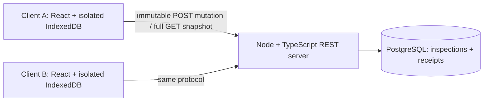

# Protocol specification

Version: protocol 1, designed in Phase 0 and server write path implemented in Phase 1, 2026-11-04. **Server record/receipt processing and POST /mutations are implemented. Phase 2 adds local drafts/queue/storage-only synthetic receipts (§11); Phase 3 adds manual push/retry and real durable acknowledgments (§12); Phase4 adds full snapshot GET and foreground reconciliation (§13 below); Phase5 adds explicit manual decisions and deletion handling (§14 below).** Examples illustrate the contract, not executed records. See the [invariants](INVARIANTS_AND_FAILURE_MATRIX.md), [decisions](DECISION_LOG.md), [evidence register](ENGINEERING_EVIDENCE_REGISTER.md), and [Phase 1 report](PHASE_REPORTS/PHASE_1.md).

## 1. System and authority



PostgreSQL owns committed record state and revisions. IndexedDB owns each client's durable drafts, frozen envelopes, and acknowledgment/conflict history. The UI can show proposed values while clearly distinguishing them from acknowledged server values. There is no global order across records and no multi-record transaction contract. One foreground sync controller per profile serializes cycles and mutation submissions. Two or three profiles/devices are supported; competing tabs on one profile are outside scope.

A `clientId` is a random UUID persisted on first initialization. It is diagnostic identity, not authorization. New independent profiles get different IDs. The local demo uses synthetic records, a loopback-only API, explicit local-origin access policy, and no public exposure. Production security is not supplied by this design.

The server database is unpruned and not replaced/restored during a supported run. Administrative database reset or rollback restoration while retaining client stores is outside the failure model. If known server IDs disappear or revisions move backward, the client blocks reconciliation and reports an incompatible server state; it must not silently delete local data or replay against an assumed replacement database. An eventual reset workflow would require explicit disposal/export decisions outside MVP.

## 2. Server data model

### Inspection

| Field | Contract |
| --- | --- |
| `id` | Client-generated random UUID, canonical lowercase hyphenated form; primary key. Never reassigned after deletion. |
| `title` | Required string, 1–200 Unicode scalar values; must contain a non-whitespace character. No automatic trimming. |
| `status` | Exactly `open`, `in_progress`, or `complete`. |
| `notes` | Required string, 0–8,000 Unicode scalar values. |
| `revision` | Server-owned positive PostgreSQL BIGINT; creation is 1; each successful update/delete adds 1. Wire/local representation is a decimal string without leading zeros. Range 1–9223372036854775807. |
| `deleted` | Server-owned boolean; false on create, true on delete; never returns to false for this ID. |

Malformed Unicode (including unpaired surrogates) is rejected. Phase 1 clarification: U+0000 is also rejected in business strings with 422 before admission because PostgreSQL text/jsonb cannot store it; all other valid Unicode scalars retain the stated limits. A UTF8 database is required. No client timestamps decide validity or ordering. Updates supply all business fields, including unchanged ones. Deletes retain last business fields but mark the row deleted; a tombstone is not secure erasure. The server keeps tombstones indefinitely within the unpruned MVP database.

### ProcessedMutation

Global unique primary identity: `mutationId` UUID. Each committed receipt stores protocol version, `clientId`, `recordId`, operation, base revision, canonical request bytes, SHA-256 request fingerprint, terminal outcome, original HTTP terminal status, committed revision if applicable, and the complete terminal response data needed to replay it. A server processing timestamp may be included for diagnostics only.

Terminal outcome is either `committed` or `conflict`. `committed` includes the full resulting record at commit. `conflict` includes a stable reason and the complete authoritative record observed during adjudication, or null for a missing record. Conflict outcomes also receive receipts. No business update occurs for a conflict. A conflict receipt remains that same outcome even if its reason would no longer apply later.

The receipt's record is historical response evidence. It is not a query for today's state. Replaying a success at revision 2 when the server is at revision 5 returns the revision-2 success, then a subsequent pull obtains current state. Replaying a conflict does not re-run revision checks or become a success.

Receipts have no TTL, including conflict receipts. UUID collision probability is an operating assumption for generating identities, while database uniqueness is the enforcement mechanism. An identical request under a new mutation ID is a new operation, subject to revision checks; content equality is not deduplication.

### Canonical immutable envelope

The exact fields, in canonical serialization order, are `protocolVersion`, `mutationId`, `clientId`, `recordId`, `operation`, `baseRevision`, `payload`. Protocol version is integer 1. UUIDs must already use the canonical representation; operation is `create`, `update`, or `delete`. Base revision is null for create, otherwise the positive decimal string described above. Payload is an object with exactly `title`, `status`, `notes`, in that canonical order, for create/update; it is null for delete.

Reject unknown/missing fields, duplicate JSON member names, invalid types, leading-zero revisions, noncanonical UUIDs, invalid scalar strings, and requests above 64 KiB of UTF-8 body before admission. No optional defaults, coercion, Unicode normalization, trimming, or unknown-property stripping changes an admitted request. The Phase 1 parser must demonstrate duplicate-member rejection; a parser that silently discards duplicates does not meet this contract.

Canonical bytes are the compact UTF-8 JSON encoding in those fixed object orders: no whitespace outside strings, standard JSON string escaping, literal Unicode scalar characters except required escapes for quote, backslash and controls; controls use their standard short escape when available, otherwise lowercase four-digit `\u` escape. Equivalent input whitespace/key order/escape spelling maps to the same canonical bytes. No other semantic equivalence is inferred. Persist these canonical bytes and their hash. Compare bytes as well as the hash on replay, avoiding a correctness dependency on perfect hash collision resistance. Hashing/canonicalization happens outside IndexedDB transaction scopes; freeze commits only if the draft version has not changed since preparation.

The client freezes identity and payload before any transmission and always resends the stored canonical envelope. Attempt counters and retry timestamps live outside the envelope. A reused mutation ID with different canonical bytes is `mutation_identity_collision`; it cannot update the existing receipt or any record. The UI blocks that record as a protocol error, preserves both local intent and error information, and does not automatically generate a replacement ID.

## 3. Server transaction and concurrency contract

PostgreSQL [transactions](https://www.postgresql.org/docs/current/tutorial-transactions.html) group changes atomically. [Unique constraints](https://www.postgresql.org/docs/current/ddl-constraints.html) enforce identities. At [READ COMMITTED](https://www.postgresql.org/docs/current/transaction-iso.html), each plain SELECT has a statement snapshot and concurrent row-update predicates are rechecked. The following algorithm is implemented in [mutations.ts](../src/mutations.ts), with schema checks in the [migration](../migrations/001_mutation_server.sql); scoped execution evidence is recorded in Phase 1.

1. Parse and validate the envelope; perform any applicable access checks before admission. The MVP has no user auth. Malformed or unauthorized attempts are not receipted.
2. Start a database transaction. Acquire ownership of `mutationId` through a unique receipt claim before any record effect. The claim is internal and uncommitted until its terminal fields are complete; no pending receipt may commit or be returned as terminal.
3. If another transaction already owns this ID, wait for its commit/rollback through uniqueness coordination. After a winner commits, read its receipt in a fresh statement, compare canonical bytes, then replay or reject identity collision. If it rolls back, the waiting contender may acquire the claim and process normally. Use conflict-aware insertion or rollback/restart handling; do not catch a uniqueness exception and continue in an aborted transaction. A fresh statement matters when a conflicting insertion was invisible to the earlier statement snapshot.
4. For an existing record, take its row lock, read current state, and check the expected revision and tombstone rule. Any conditional update must still include the expected revision and `deleted=false`. Lock/compare/write/receipt remain in the same transaction. A zero-row condition is not success. Missing update/delete yields a receipted `record_missing` conflict, never an implicit insert.
5. For create, attempt an insert protected by the unique record identity. If a competing create wins, observe it in a fresh locking read and record `record_exists` or `record_deleted`. A duplicate-key race must not abort the transaction that needs to write a conflict receipt; use conflict-aware insertion or a safely rolled-back attempt. Records are never physically removed in this model, simplifying identity arbitration.
6. Fill the terminal receipt, including the exact success record or locked conflict observation, and commit. Success effect and success receipt become visible together. Conflict receipt commits without a record change. Respond only after commit is confirmed. If transaction outcome itself is uncertain at the server connection, return no invented terminal outcome; the client replays the ID.

Distinct IDs targeting revision r serialize on the record: one qualifying write can advance r to r+1; another from r conflicts. Distinct create IDs targeting the same absent record yield one creation and a conflict receipt for the other. Different records can proceed independently. Same-ID same-payload concurrent requests produce one terminal receipt and at most one effect. Same-ID different-payload contenders produce one winner (possibly conflict), then collision for the mismatching request. Timeout while waiting for an owner is retryable, not a business conflict.

No table-wide serializable guarantee is claimed. A deferred PostgreSQL constraint trigger queries each receipt's final row at commit and rejects incomplete claims; a separate trigger prevents changes to terminal receipts or the claimed immutable envelope. The Phase 1 tests exercise both. A revision overflow is a server failure with transaction rollback and no terminal receipt, never a wrapped revision or silent success. Repeated failure blocks progress visibly.

## 4. Operation semantics

| Operation | Required condition at adjudication | Committed result | Terminal conflict otherwise |
| --- | --- | --- | --- |
| Create | `baseRevision=null`, full payload, no row with ID | New active record at revision 1 | Existing active row: `record_exists`; tombstone: `record_deleted`. |
| Update | Full payload, row active, exact base revision | Replace business fields; revision +1 | `record_missing`, `record_deleted`, or `stale_revision`. |
| Delete | `payload=null`, row active, exact base revision | Retain fields, set deleted=true; revision +1 | `record_missing`, `record_deleted`, or `stale_revision`. |

Reason priority is missing, then deleted, then stale revision. A no-change update still advances once when valid. Repeated delivery with the same ID replays the original result for every operation. A delete with a new ID against an existing tombstone conflicts even when its base matches; it does not increment again. A stale update is never converted to create. Restoring an old deleted identity is forbidden. Explicitly copying preserved values into an entirely new inspection is a separate user action, not automatic conflict resolution.

## 5. REST contracts

### POST /mutations

Content-Type application/json. One envelope per request; no batch endpoint. This update example is an illustrative request, not an executed call:

```json
{
  "protocolVersion": 1,
  "mutationId": "20000000-0000-4000-8000-000000000001",
  "clientId": "10000000-0000-4000-8000-000000000001",
  "recordId": "30000000-0000-4000-8000-000000000001",
  "operation": "update",
  "baseRevision": "4",
  "payload": {"title": "Pump inspection", "status": "complete", "notes": "Seal replaced"}
}
```

Create has the same envelope fields with `operation=create`, `baseRevision=null`, and full business payload. Delete uses `operation=delete`, a non-null base, and `payload=null`. These variants must pass the same identity rules.

Successful first response, HTTP 200:

```json
{
  "protocolVersion": 1,
  "mutationId": "20000000-0000-4000-8000-000000000001",
  "replayed": false,
  "outcome": {
    "kind": "committed",
    "committedRevision": "5",
    "record": {
      "id": "30000000-0000-4000-8000-000000000001",
      "title": "Pump inspection", "status": "complete", "notes": "Seal replaced",
      "revision": "5", "deleted": false
    }
  }
}
```

A duplicate response has the same protocol version, ID, status and `outcome` with `replayed=true`. This transport flag is not part of the immutable stored outcome. The same rule applies to conflict replays (HTTP 409 remains 409).

Illustrative conflict variant for a separate stale request:

```json
{
  "protocolVersion": 1,
  "mutationId": "20000000-0000-4000-8000-000000000002",
  "replayed": false,
  "outcome": {
    "kind": "conflict",
    "reason": "stale_revision",
    "expectedRevision": "4",
    "remoteAtDecision": {
      "id": "30000000-0000-4000-8000-000000000001",
      "title": "Pump inspection", "status": "complete", "notes": "Another inspector's notes",
      "revision": "5", "deleted": false
    }
  }
}
```

`remoteAtDecision=null` only for `record_missing`. The value is fixed in the receipt, even if a later pull gives revision 6. Do not label a replayed conflict observation as the latest server state.

Identity collision, HTTP 409: `{ "protocolVersion": 1, "mutationId": "...", "error": { "code": "mutation_identity_collision" } }`. Here `...` denotes a schema placeholder, not a literal valid UUID. No new receipt or record change occurs; do not expose another request's full payload in this error.

Pre-admission errors use `{ "error": { "code": "...", "message": "..." } }`, with codes `invalid_json` (400), `unsupported_media_type` (415), `body_too_large` (413), or `invalid_envelope` (422). Invalid-envelope details identify invalid fields without a terminal mutation outcome. Unauthorized/forbidden submissions, if access control is introduced later, fail before admission with 401/403; they are not an implemented feature. Retryable failures use 429 or 5xx, with no claimed terminal outcome; a Retry-After hint may be included.

The client accepts a terminal result only from a complete, schema-valid response for its expected mutation ID/protocol and consistent record identity/revision/result kind. HTTP status alone is insufficient. Unexpected IDs, truncated bodies, malformed terminal data, and transport errors keep the original outcome unknown. A collision is a blocked protocol error. A validation failure stops automatic sending and preserves the envelope for diagnosis; it must not be silently edited/re-IDed.

A valid pre-admission error describes rejection of that invocation only. It does not prove an earlier timed-out attempt never committed. If a previously issued envelope now receives such an error, preserve any prior uncertainty and require diagnostic recovery of the same ID. Client cancellation, connection reset, timeout, fetch rejection, intermediary error, 429 and 5xx cannot safely establish rejection of a previous attempt. A definitive committed/conflict receipt is the normal terminal authority.

### GET /inspections

Return HTTP 200 with protocol version, `complete=true`, `recordCount`, and `records` containing every row in the demo database, active and deleted, in stable ID order. Example shape:

```json
{
  "protocolVersion": 1,
  "complete": true,
  "recordCount": 1,
  "records": [
    {"id": "30000000-0000-4000-8000-000000000001", "title": "Pump inspection",
     "status": "complete", "notes": "Seal replaced", "revision": "6", "deleted": true}
  ]
}
```

The server executes one plain SELECT over all inspection rows in one statement snapshot, then derives count from those same materialized results. No independent count query, independently paginated reads, row filtering that hides tombstones, or max-revision global cursor. A single-query READ COMMITTED snapshot is sufficient for this limited read contract. A future multi-query implementation would require one explicit consistent database snapshot and a revised design review.

Use `Cache-Control: no-store`; the client requests uncached data. Completion means the query results were fully read and encoded, not that no later write exists. No timestamp or HTTP receipt time is a synchronization watermark. Validate full body, uniqueness, revisions, count, completeness and schema before installing anything. A failed/truncated snapshot changes no clean state and preserves last-success metadata. There is no cursor and no optional health endpoint.

## 6. Client durable state and transitions

Conceptual IndexedDB stores (design fields, not a schema migration):

- `cleanRecords[id]`: last accepted authoritative record, including tombstones; never holds an unsent proposal.
- `work[id]`: draft version, local intended business state/operation, base revision, complete common-base record when available (null for new creation), active mutation link, resolution source/history link, conflict visibility and blocked-error details.
- `mutations[mutationId]`: immutable envelope/canonical bytes/fingerprint, base/common-base copy, intended state, durable phase (`queued`, `outcome_unknown`, `acknowledged`, `terminal_conflict`), attempt count/timing, terminal receipt and original conflict observation when known. A separate blocked error can accompany an unresolved phase.
- `metadata`: persistent client ID, last successful snapshot completion, last completed reconciliation observation. These are local observations, not global clocks or cursors.

Keep mutation and resolution history for the local demo; no automatic eviction is designed. A unique active work slot per record enforces at most one queued/unknown logical mutation, including resolutions. Local acknowledged history is not an outstanding mutation. Storage grows with retained history; handling quota failure preserves the previous committed state and shows that the new edit was not saved.

| State / UI label | Durable content and permitted transitions |
| --- | --- |
| Clean | Authoritative snapshot only; may start an editable draft from this base. Tombstones cannot be edited as active records. |
| Unsent draft | `work` preserves common base and intended values in a local transaction. Editable without issuing a mutation ID. Cancel requires explicit user action. Pull may flag a changed base but must preserve it. |
| Queued | Atomically install immutable envelope and lock/link the work row after rechecking draft version and active slot. Report queued only after transaction completion. No further editing/cancellation of that record; a future transmission may already be possible. |
| In flight | Transient UI label only. Before transport, atomically persist `outcome_unknown` plus attempt metadata. A crash after this commit but before sending is safe. |
| Outcome unknown | Persisted across restart. No replacement ID, rebasing, cancellation, or conflict diagnosis from snapshots. Replay the exact envelope until terminal result or a visible blocking error. |
| Applied / acknowledged | One local transaction stores terminal success receipt/history, conditionally advances clean state, removes active queue/work link, and records acknowledgment. It may be followed by a newer pull. This state survives restart but does not alone imply synced. |
| Terminal conflict | One transaction stores receipt, original base/proposal, `remoteAtDecision`, and visible conflict; removes active send eligibility. No automatic retry under a new ID or draft dropping. Pull refreshes separately stored latest remote state. |
| Resolution draft | Explicit user action from a known conflict, with fresh latest server record as its new common base. Preserve original conflict history. Editable until new freeze; original terminal receipt is never modified. |
| Resolution queued/unknown | A new mutation ID, normal queue/unknown rules, record locked. A lost resolution acknowledgment is replayed with this same resolution ID. A second conflict becomes another preserved terminal conflict. |
| Blocked error | Persist diagnostics alongside intact work/envelope. Validation/collision/storage/server-incompatibility errors prevent a false synced label. Automatic new-ID replacement is forbidden. |

All saved work and queue/outcome/receipt states persist under ordinary browser restart assumptions. `in_flight`, spinner/progress, connection hints and timers are transient. Startup treats persisted `outcome_unknown` as recovery work regardless of whether a request was actually sent. A draft being typed but never committed to IndexedDB is not promised to survive; the UI must distinguish saving from saved locally.

### Local transaction boundaries

Draft saves update only persistent local work. Freeze writes envelope + work link/lock in one read-write transaction. Perform UUID generation, canonical preparation and hashing first; recheck draft version in the transaction so an intervening edit cannot be frozen accidentally. On abort/quota error, retain the previously committed draft, send nothing, and show failure.

Attempt marking commits before fetch. Fetch and response validation happen outside IndexedDB transactions. Acknowledgment/conflict processing updates all affected stores in one transaction, matching the active mutation link to avoid clearing unrelated work. If acknowledgment persistence fails, leave the original unknown mutation eligible for identical replay. Do not tell the user it is locally acknowledged until this commit completes. Duplicate terminal responses with equal stored outcome are local no-ops; differing terminal outcomes for one ID are protocol errors.

Never await HTTP, timers, cryptographic work or other unrelated asynchronous APIs inside Dexie/IndexedDB transaction scope. [Dexie explains auto-commit and scope constraints](https://dexie.org/docs/Dexie/Dexie.transaction%28%29). Atomicity is not a claim of hardware-level durability: [IndexedDB durability hints](https://developer.mozilla.org/en-US/docs/Web/API/IDBTransaction/durability) have different semantics. Phase 2 will record browser version, profile path, durability support/hint, and observed restart behavior. Default durability is the initial plan; do not claim strict behavior without verifying wrapper/runtime support. Eviction, cleared storage, private browsing, corrupt storage, OS/power failure and hardware failure remain unsupported.

## 7. Retry policy and sync cycle

Manual Sync and foreground startup offer retry opportunities. A foreground reachability/online event may offer another bounded cycle; no service worker, background delivery, or perpetual timer is required. `navigator.onLine` is a hint only. The controller prevents overlapping cycles.

Each request gets at most five attempts within a cycle, each with a 10-second client timeout. Before retries 2–5, wait respectively 1, 2, 4 and 8 seconds multiplied by seeded-testable jitter in [0.8, 1.2], capped at 30 seconds. If a valid Retry-After exceeds the next delay, use it up to 30 seconds; if it exceeds 30 seconds, stop this cycle and persist a not-before time for a later opportunity. Tests use a fake clock for scheduling, not sleeps. A timeout aborts local waiting, not the server transaction.

After five ambiguous/retryable failures, retain unknown/queued work and show retry needed. Successful independent records need not roll back. A definitive receipt ends attempts for its ID; validation/collision stop automatic attempts immediately. A later manual/startup opportunity resets the per-cycle attempt budget but keeps ID, envelope, history, and not-before constraint. A stalled/closed client cannot converge without a later opportunity. Recovering unknown records can fail while other independent records proceed; their locks/ambiguity remain intact.

Safe cycle, with network steps outside local transactions:

1. Load persistent work and recover all previously attempted `outcome_unknown` mutations by exact POST replay. Process terminal receipts atomically. Exhausted/blocked unknowns remain locked; do not diagnose them from any newer snapshot.
2. Pull one full consistent snapshot. On failure, stop normal submissions this cycle (already recovered effects remain committed). On success, install clean records atomically while preserving all drafts/mutations. A draft with an old base gets a visible `base_changed` warning, not a forged server conflict receipt or automatic rebase.
3. Submit eligible never-attempted queued mutations, sequentially across independent records, after durable attempt marking. Their frozen base is unchanged even if pull found a newer revision; the server decides and records the terminal conflict. Preserve unknown/conflict records and continue other independent records if possible.
4. Pull again after submissions/recovery and reconcile. Keep unresolved proposals visible. If this pull fails, terminal receipts are still safely stored, but no new synced observation is claimed.

Snapshots update `cleanRecords`, never replace work. Replayed committed/conflict records may advance clean state only if their revision is greater; equal revisions must have equal state; lower historical records stay in receipt/history and never downgrade clean records. Before installing a snapshot, require all already-known authoritative IDs to be present, with revisions at least as high as clean state and equal state at equal revisions. Reject the whole snapshot on missing IDs, rollback, or equal-version mismatch; preserve current clean/work state and surface incompatibility. A pending local create has no authoritative clean ID yet, so its absence is expected. The single controller serializes local application and avoids overlapping snapshot completions.

An r-to-r+1 unknown mutation might already have committed while another client advanced to r+2. Recovery obtains the original r+1 success; it is not a stale-write conflict. If no earlier commit occurred and r+2 exists, original replay yields a receipted stale conflict. This distinction is why snapshot comparison must never decide an unknown mutation's outcome.

### Locally synced and conditional reconciliation

For a record, locally `synced` requires no draft, queued/unknown mutation, unresolved conflict or blocked error; all accepted local outcomes must be acknowledged; and a completed final snapshot query begun after that cycle's submissions must include its current clean state. For the client, every record must meet those requirements and the complete final snapshot must be installed. An empty untouched client still needs its first successful snapshot. A dirty draft may have clean data refreshed, but is not synced.

Display the last successful reconciliation as an observation, not proof of current global equality. A server write can commit immediately after the read. Conditional eventual reconciliation requires eventual reachability, repeated opportunities, a finite/quiescent set of writes for convergence, fair progress, functioning persistent storage and databases, retained receipts/tombstones, and users eventually resolving conflicts. After a sufficiently late successful cycle under those conditions, clean client records match the stable server state and no work remains. Continuous writes, unresolved user decisions, unavailable storage or permanently stopped retries defeat that conclusion.

## 8. Conflict, deletion, and extended disconnection

Preserve four distinct things: original common base (if available), original local proposal, immutable terminal outcome with its remote-at-decision observation, and separately refreshable latest remote state. Whole-record conflicts may arise even for disjoint field edits. Never automatically discard proposals.

After a terminal conflict, fetch current server state before creating a resolution draft. Options are:

- **Keep server:** show what will be discarded; require explicit confirmation; atomically archive the decision and clear the active local proposal. Leave immutable conflict history intact. This does not write the server.
- **Reapply local values intentionally:** for an active remote row, copy local business values into a new resolution draft with latest remote revision/common base, then freeze a new mutation. It may conflict again. It is not a forced overwrite.
- **Manual merge:** user constructs full business values from base/local/remote and queues a new mutation against the latest active revision. Delete intent can similarly be reconsidered and resubmitted against a latest active revision.

A latest tombstone disables update/reapply-to-this-ID; the user can keep deletion or explicitly copy values to a new inspection identity. A create identity collision cannot become an implicit update; preserving/copying the proposal uses a deliberate new record ID. A genuinely missing row during resolution is a visible anomaly for a previously known server ID; do not manufacture a base revision or resurrection.

Once a resolution freezes, that record locks again. Even if a new pull shows different data, an unknown resolution must replay its existing ID before another resolution may be generated. A successful resolution whose HTTP response was lost is still one operation, not permission to submit a second resolution.

A client reconnecting after simulated weeks first resolves any unknown outcomes, then receives a full snapshot with tombstones. Old unattempted mutations remain valid envelopes but may conflict on revision/deletion. Receipts, tombstones, and accepted revision comparisons have no time expiration. Time passage has no special correctness effect. There is no cursor to expire. A future incremental protocol would require detecting an expired cursor and a full resync that retains local work; that is deferred. Simulated weeks establish protocol behavior after other writes, not weeks of physical browser-storage survival.

## 9. Crash windows and guarantee boundaries

| Control point | Durable possibilities and required recovery |
| --- | --- |
| Before draft/freeze commit | Only prior committed local state is promised. No network transmission of an unfrozen request. |
| After freeze, before attempt marker | Queued envelope survives ordinary restart; send it unchanged. |
| After marker, before send | Outcome unknown even if nothing was sent; safe identical POST resolves it. |
| Server before transaction commit | Any row effect and receipt roll back together; replay may process normally. |
| During uncertain server commit | Client cannot infer effect; POST the same ID until the database resolves its receipt. |
| After server commit, before response | Effect and terminal receipt exist; replay returns original result. |
| Response received, before local acknowledgment commit | Original unknown work remains; replay safely re-obtains receipt. |
| During local acknowledgment transaction | Either old unknown state or complete acknowledgment/conflict state, not a half-cleared queue. |
| After local acknowledgment commit, before final pull | Success is recorded; synced observation waits for successful reconciliation. |
| Interrupted snapshot response/local install | Keep prior complete clean state and all work; retry complete pull. |

Preservation of acknowledged server state means committed effects are not undone by supported HTTP/application-process failures or stale writes. Later valid writes may supersede values. PostgreSQL configuration and working durable storage are assumptions, not an implemented backup or hardware-failure guarantee. No claim is made of zero data loss, exactly-once delivery, unconditional eventual consistency, formal proof, or production readiness.

Scenario assertions and the distinction between real process lifecycle tests and simulations are in the [failure matrix](INVARIANTS_AND_FAILURE_MATRIX.md). Phase 1 backend evidence is recorded separately from complete future client/browser scenarios, which remain **NOT RUN**.

## 10. Phase 1 implementation details and evidence boundary

POST /mutations uses the exact fields, terminal statuses and response variants above. Raw HTTP bodies are limited to 65,536 bytes, decoded as fatal UTF-8, and parsed with duplicate-decoded-member detection before canonicalization. Application/json optionally permits a correctly quoted or unquoted UTF-8 charset. Other charsets/content encodings return 415; malformed UTF-8, BOM-prefixed JSON and duplicate keys return 400. NUL in a business value returns 422. Fixed-order reconstruction precedes compact JSON encoding; input object order never controls identity.

The normal server binds loopback and enforces a configured loopback browser Origin. Disallowed Origin returns 403 `origin_not_allowed` before admission. Origin-less CLI requests are allowed; this policy supplies no authentication. No other endpoint, including GET /inspections or health, was added in Phase 1. Unknown routes return 404. Unclassified internal/database failures return 500 `server_error` without a terminal mutation outcome; receipt replay remains necessary after uncertainty. There is no automatic server transaction retry: lock/statement timeouts roll back and leave an ambiguous HTTP error for a later same-ID request.

`processed_mutations` has global mutation_id uniqueness, canonical_request text, fingerprint hex, operation/target/base, outcome/http_status/committed_revision, and a stored full original JSON response with replayed=false. JSON object member ordering in a stored/replayed response is not a byte-level wire promise; outcome values, ID, status and historical snapshots are preserved. Replay changes only the outer replayed flag. No record foreign key is imposed on record_id because `record_missing` conflicts must still be receipted. Parameterized business SQL uses one checked-out connection per transaction. Request processing has no process mutex or global advisory lock; migration-only locking is separate.

Tests receive trusted in-process hooks; process lifecycle tests additionally require NODE_ENV=test, SYNCPROOF_TEST_PROCESS=1 and a parent IPC channel. Hooks have no HTTP route/header/environment-only normal-runtime access. Their actual points are before_receipt_claim, after_receipt_claim_before_record, before_record_lock, after_record_write_before_commit, and after_commit_before_response. Full client-side/future harness hooks remain deferred. Evidence shows real Node termination on both sides of commit; it does not show PostgreSQL, OS, browser, or hardware restart durability. See [retained test output](evidence/phase-1/final-tests.txt).

## 11. Implemented Phase 2 local client

[LocalStore](../client/lib/storage.ts) is Dexie schema version1: work (`&id,phase`), mutations (`&mutationId,recordId,phase`), cleanRecords (`&id`), metadata (`&key`). Normal startup creates only stable clientId metadata; cleanRecords starts empty. Browser-safe contract code in [contract.ts](../client/lib/contract.ts) retains the Phase1 validator/canonical ordering, with Web Crypto SHA-256 prepared before transactions and a 64KiB encoded limit. Conformance tests compare browser canonical envelopes and hashes to src/contracts.ts; the backend was not refactored.

`saveDraft` validates first, then writes payload/version/base/commonBase in a read-write transaction and returns only after completion. It preserves an existing null base rather than silently rebasing. `freeze` reads the saved draft, prepares UUID/hash outside the transaction, then atomically rechecks version/active slot, inserts immutable mutation and locks work. Double/repeated requests cannot replace an issued identity. Editable draft discard requires explicit UI confirmation; queued work cannot be discarded/edited. No asynchronous crypto, timer or network wait occurs inside these transactions.

| Local state | Implemented behavior |
| --- | --- |
| Unsaved form | In-memory only; UI says Unsaved changes; not promised after restart. |
| draft | Durable editable work; UI says Saved locally after transaction completion. |
| queued | Work locks; envelope/canonical/hash retained; UI says Queued on this device, never server accepted. |
| Storage error | Error UI; previous committed state remains; failure is not saved success. |
| outcome_unknown | Reserved durable metadata and test fixture reopening only; no attempt marker or transport controller implemented. |
| acknowledged / terminal_conflict | Storage-only synthetic seam/test values; no network receipt application or UI resolution. |

`applySyntheticReceipt` validates identity/revision/outcome outside storage work, then atomically updates historical receipt, queue phase, clean state and work. Synthetic success clears matching work only in that transaction; conflict retains proposal/base and original receipt. Lower historical revisions cannot replace newer clean records; equal revisions must have equal fields. Repeated equivalent receipt outcomes compare semantically, not by member order. There is no UI or network pathway to this method. It prepares transaction boundaries for Phase3 without claiming synchronization.

Default IndexedDB durability is observed, not upgraded to a hardware guarantee. Real Chromium graceful full close/relaunch and reload were tested with retained profile/origin; fake-indexeddb is used only for logic. [Phase2 evidence](evidence/phase-2/browser-lifecycle.json) records actual PIDs/version/default hint. No startup clear/reset, fake authority, service worker, API call, retry, pull or resolution UI exists. Full F5 recovery after future network sends remains deferred.

## 12. Implemented Phase 3 foreground push

[PushController](../client/lib/push.ts) submits only frozen mutations via the loopback Vite /api/mutations proxy to POST /mutations. ALLOWED_ORIGIN must match http://127.0.0.1:5174. No server change, new dependency, IndexedDB store/index or schema version change was necessary. Optional attemptCount/lastAttemptAt/notBefore/lastError/blocked fields augment version1 mutation rows; absent legacy fields default safely. Phase2 milestone descriptions above preserve their historical scope.

`pending` orders outcome_unknown ahead of queued. Before EVERY send the controller rereads persisted canonical/envelope/hash, checks integrity outside a transaction, then `markAttempt` commits outcome_unknown/count/time in a short work/mutation transaction. HTTP and response body decoding happen afterward, outside all Dexie transactions. A crash after marking but before send is conservatively replayed with the original ID. Only one run can be active per controller; overlapping callers share its promise. No startup send, navigator.onLine inference or background scheduler exists.

The adapter inspects HTTP status AND complete body. It validates protocol/ID/outcome/record/revision and intended values. Valid HTTP200 committed or409 domain conflict goes through `applyReceipt`, the same atomic transaction retained behind the Phase2 synthetic wrapper. Receipt, mutation terminal phase, monotone clean metadata and matching work transition commit together. A local abort leaves unknown work and the original envelope eligible for replay; no false acknowledged state. Success clears only matching work, retains history and permits a new independent draft/ID. Conflict keeps common base/proposal/original remote snapshot locked. Equal receipt values compare semantically, not by member order. BigInt compares revisions; historical receipts cannot lower clean state or clear a later unrelated draft.

Network rejection, fetch abort/timeout, unreadable/malformed/mismatched response,429/5xx or unexpected HTTP errors leave an unknown result. A known identity collision or recognized admission/origin error stores blocked diagnostics without a terminal receipt or replacement ID. Earlier attempts may still have committed, even when the current invocation is rejected. Blocked work is not auto-repaired or discarded; no resolution controls exist.

Each foreground cycle allows five attempts/request, 10s request/body timeout, waits of1/2/4/8s with jitter[0.8,1.2], 30s cap and test-injected clocks/waits. Valid Retry-After beyond30s stores notBefore and stops that record's cycle, including when an error body is unreadable. Budget exhaustion preserves unknown state for a future manual attempt. Independent records proceed sequentially; a stopped cycle preserves acknowledged/unknown/never-attempted states separately. There is no claim of synced/global equality without Phase4 pull.

Real integration tests forward intercepted HTTP to the actual PostgreSQL service, inspect committed receipt/state, THEN abort the browser response. Separate native IndexedDB abort, stale conflict, collision, historical replay, rapid-click, malformed-response, partial batch and retained-profile restart cases are recorded in [Phase3 report](PHASE_REPORTS/PHASE_3.md). Interception lives in Playwright, not a normal HTTP fault endpoint. Synthetic fixtures and server writes used to advance a record are explicitly test-only.

## 13. Phase 4 implemented snapshots — 2026-11-04

GET /inspections performs one ordinary SELECT of all rows including tombstones ordered by id; revision::text preserves BIGINT. Response is {protocolVersion:1,complete:true,recordCount,records}; count derives from that same materialized query, never a second statement. No filters, pagination, cursor or global revision. Cache-Control remains no-store. PostgreSQL READ COMMITTED supplies a statement snapshot; an actual exclusive-lock/concurrent-commit test checks a coherent pair of records. This test's parent-only multi-row SQL transaction is a read-consistency fixture, not a new client write API.

pullSnapshot validates successful HTTP200, complete marker/count, exact record shape, legal business fields/UUID/revision/deleted values and duplicate IDs before writing. The existing v1 cleanRecords/metadata stores suffice. applySnapshot checks every known ID is present, revisions do not decrease, equal versions have equal state and tombstones never reactivate; ANY mismatch rejects the entire snapshot and retains old state. Unknown local-only creates absent remotely are not in cleanRecords and remain untouched. Clean rows and lastSnapshot metadata commit together; no network/crypto waits inside. Draft/base/commonBase, queued bytes/locks and conflict history are never written by pull. Latest remote state lives separately in cleanRecords. A native IndexedDB mid-write abort verifies all state stays unchanged.

The existing PushController running-promise guard now covers manual Reconcile now: recover unknown IDs; full pull/apply; submit genuinely queued IDs; full pull/apply. Editable drafts are not automatically frozen. Unknown exhaustion does not infer conflict from remote state. snapshotApplied is reported only if that cycle actually completed its final pull; overlapping send/reconcile actions cannot manufacture a pull-success label. UI reports an observation as of completed pull, never permanent global equality; pending drafts/conflicts may remain. Remote-base warnings require an actual authoritative counterpart, never a local-only create.

P4 decisions: retain strict whole-snapshot rollback/missing-ID rejection from Phase0; reuse v1 stores with lastSnapshot metadata (no migration/index change); preserve immutable historical receipts separately; expand existing loopback /api proxy; retain bounded foreground/timeouts. Snapshot SQL is O(N) transfer/materialization; local map O(N), scan O(K) known clean rows, indexed puts O(N log N) storage work approximately plus payload copying, with O(N+K) maps/arrays and retained draft/history growth. No capacity/performance measurements are claimed. Full arrays intentionally fit the bounded demo, not arbitrary production datasets.

Executed evidence: [four local checks](evidence/phase-4/snapshot.txt), [seven new real browser/PostgreSQL cases](evidence/phase-4/snapshot-browser-final.txt), [full browser suite](evidence/phase-4/browser-final.txt), [backend45](evidence/phase-4/backend.txt), [local13](evidence/phase-4/local.txt), [push9](evidence/phase-4/push.txt), [build](evidence/phase-4/build-final.txt). New cases: endpoint/tombstones; two-browser same-base edits and preserved losing proposal; three independent contexts with converged clean state and A's preserved draft; unknown original receipt recovered before newer pull; actual delayed old HTTP response rejected; native snapshot abort/503 recovery; concurrent SQL boundary and simulated21-day clock jump. Browser contexts have independent IndexedDB; no claim of multiweek physical durability.

Coverage advances INV-SNAP-01/INV-DRAFT-01/INV-UNKNOWN-01/INV-TOMB-01 and conditional INV-RECON-01. F1 recovery-before-pull and F7/F8 conflict preservation gained browser layers; F4/F5 earlier regressions reran; F10 gains simulated-duration/tombstone observation only. F6 actual Node restart remains separately rerun backend evidence. F9 interrupted resolution and complete Phase6 repeated scenarios/eight-step demo remain NOT RUN. No resolution/merge, cursor, log, service worker, live stream, background sync or deployment was added. Conditional convergence assumes quiescence, repeated reachable opportunities, intact storage and eventual human conflict decisions; unresolved conflicts deliberately do not disappear.

An attempt after the paused chat found PostgreSQL unavailable and seven setup failures occurred before test bodies (ECONNREFUSED). Output is preserved in snapshot-browser-database-unavailable.txt; the project-owned cluster was restarted and all seven cases rerun. Final counts are separate from that failed environment attempt and earlier passing runs.

Current next gate: owner review of Phase4; do not start Phase5. See [Phase4 report](PHASE_REPORTS/PHASE_4.md) for the individual A01–A22 audit.

## 14. Phase 5 explicit manual decisions — 2026-11-04

Server protocol 1 and all record/receipt SQL are unchanged. Original conflict remains `{protocolVersion:1,mutationId,replayed,outcome:{kind:"conflict",reason,expectedRevision,remoteAtDecision}}`. Historical receipt content never becomes a substitute for latest `cleanRecords`. Existing decimal positive BIGINT revision strings, strict business/UUID validation, canonical field order and SHA-256 apply to resolutions unchanged.

Dexie v1 retains work/mutations/cleanRecords/metadata. Optional work `resolutionOf`/`intent`, mutation `resolves` and local `decision:{kind:"keep_server",at}` need no store/index migration; old rows remain valid with fields absent. Original envelopes, canonical bytes, fingerprints and terminal receipts are never edited by these decisions. Local decision metadata is separate from the immutable server outcome.

Current actionable conflict is `work.activeMutationId`; an editable resolution draft points back via `resolutionOf`. Terminal conflict → explicit latest review → editable resolution → explicit freeze/queue → unknown before POST → acknowledged or second terminal conflict. Cancel editable resolution atomically restores original work/proposal. A second conflict becomes active, retaining its predecessor pointer and both immutable attempts. No dependent network queue chain exists. A terminal historical attempt is not outstanding network work.

Review latest shares the existing controller promise guard and does unknown recovery then pull only. Choices require a completed current review; storage rechecks matching active conflict and observed remote revision. Keep-server requires explicit confirmation; one local transaction records decision and removes unresolved work, leaving clean state/history intact, with no POST. It is prohibited after resolution drafting/queueing/unknown; cancel a draft first. This decision does not promise the remote is still unchanged.

For live update conflicts, reapply uses rejected values; manual combination begins with latest remote values and lets the person explicitly edit title/status/notes. New draft captures reviewed base/commonBase. Validation runs before writes and again at freeze. ID generation/canonicalization/crypto finish before the read-write transaction; it rechecks draft version and clean revision then atomically adds the new immutable mutation, `resolves` pointer and lock. If locally observed remote changed, cancel and review again; if only server changed, the existing revision gate returns a second conflict. No direct SQL write bypass or old-ID rebase.

A live clean record may queue a confirmed delete using current revision and null payload. A stale delete versus newer live state can prepare a new confirmed revision-checked delete. A tombstone permits keep-server only: neither update nor delete becomes create/restore; no duplicate automatic delete/version bump, physical deletion or pruning. Create identity conflict cannot be an implicit update; manually copy information to a separate new inspection if needed. Information in a tombstone conflict can be copied outside the record; arbitrary restore remains outside MVP.

Queued and unknown resolutions lock editing/contradictory decisions. Existing unknown-before-send, integrity checks, bounded retry, receipt validation and atomic acknowledgment paths apply. Same ID/canonical bytes recover after dropped response or local acknowledgment abort. Historical success at6 is recorded as history while later pull retains/advances clean7. No inspector-open auto-send; explicit Send/Retry/Reconcile retain their existing meaning.

Executed scope and case mapping: [Phase 5 report](PHASE_REPORTS/PHASE_5.md), [resolution units](../tests/resolution.test.ts), [real browser/PostgreSQL tests](../tests/browser/resolution.spec.ts), [F9 lifecycle](evidence/phase-5/f9.json). Full F1–F10 repetition and eight-step demo remain unrun; simulated21-day clock is not multiweek disk durability. No Phase6/7 work.
