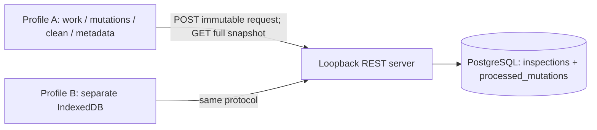

# SyncProof engineering handbook

Source-grounded guide, 2026-11-05. Read [README](../README.md) for commands, [protocol](PROTOCOL_SPEC.md) for the contract, [Phase6 audit](PHASE_REPORTS/PHASE_6.md) for failure schedules, [performance report](PERFORMANCE_REPORT.md) for measurements and [release review](RELEASE_READINESS.md) before public sharing. Exercises are independent work, not claims about the owner's mastery.

## Contents

1. [Mental model](#1-mental-model)
2. [Components and request flow](#2-components-and-request-flow)
3. [Envelope and canonical identity](#3-envelope-and-canonical-identity)
4. [PostgreSQL concurrency and crash windows](#4-postgresql-concurrency-and-crash-windows)
5. [IndexedDB and Dexie transactions](#5-indexeddb-and-dexie-transactions)
6. [Push and uncertain HTTP](#6-push-and-uncertain-http)
7. [Snapshots and reconciliation](#7-snapshots-and-reconciliation)
8. [Conflict decisions and deletion](#8-conflict-decisions-and-deletion)
9. [Failure evidence and detailed traces](#9-failure-evidence-and-detailed-traces)
10. [Complexity and measured performance](#10-complexity-and-measured-performance)
11. [Security and scaling boundaries](#11-security-and-scaling-boundaries)
12. [Production-tool comparison](#12-production-tool-comparison)
13. [Interview questions](#13-interview-questions)
14. [Independent learning plan](#14-independent-learning-plan)

## 1. Mental model

An inspector saves title/status/notes locally, then explicitly freezes an operation. PostgreSQL owns committed inspection values, positive decimal revisions and terminal mutation receipts. Each independent browser owns editable work, issued immutable requests, processing metadata, historical receipts and latest observed clean records. A form value or queue entry is not evidence of server acceptance.

The domain keeps the example concrete; the problem is ambiguity across two transaction systems and HTTP. A browser cannot atomically commit its IndexedDB acknowledgment with a remote SQL commit. Instead it records an unknown marker before transmission and retains the issued identity until replay reveals the durable server outcome.

A record ID identifies an inspection. A mutation ID identifies one immutable attempt. A revision identifies one authoritative version of one record. A resolution is another attempt against a reviewed base, never an edit to an issued request. Decisions and receipts remain local history after work is released.

Two tabs in one profile are not independent clients. Supported operation assumes one active controller/tab per profile. The frontend shell must remain reachable after restart; there is no service worker or offline cold-load guarantee.

## 2. Components and request flow

| Source | Actual entry points and responsibilities |
| --- | --- |
| [src/contracts.ts](../src/contracts.ts) | InputError, parseMutation; strict JSON/envelope/business validation, canonical request and Node SHA-256. |
| [src/app.ts](../src/app.ts) | createApp; origin policy, raw UTF8 admission, POST /mutations, one-query GET /inspections, errors. |
| [src/mutations.ts](../src/mutations.ts) | processMutation; private adjudicate; receipt ownership, replay/collision, row lock/revision and commit. |
| [src/db.ts](../src/db.ts) | createPool, migrate; validated schema, timeouts, transactional checksum-checked migrations. |
| [src/server.ts](../src/server.ts) | Environment/UTF8 checks,127.0.0.1 bind, lifecycle, guarded test-only IPC checkpoints. |
| [migration](../migrations/001_mutation_server.sql) | Tables, primary-key indexes, constraints, deferred terminal-receipt and immutability protections. |
| [client/lib/contract.ts](../client/lib/contract.ts) | Browser contract copy; prepareMutation uses Web Crypto; conformance tests compare Node results. |
| [client/lib/storage.ts](../client/lib/storage.ts) | LocalStore; initialize/saveDraft/freeze, applySnapshot, pending/markAttempt/noteFailure/applyReceipt, beginResolution/cancelResolution/keepServer/queueDelete. validateReceipt checks responses. |
| [client/lib/push.ts](../client/lib/push.ts) | deliver; PushController.sendPending/reviewLatest/synchronize, retries and shared running promise. |
| [client/lib/pull.ts](../client/lib/pull.ts) | validateSnapshot and pullSnapshot; complete typed response before writes. |
| [client/main.tsx](../client/main.tsx) | App; explicit save/queue/send/reconcile/select/delete and durable status/errors. |
| [client/conflict.tsx](../client/conflict.tsx) | ConflictPanel; original base/proposal/receipt versus latest clean, reviewed decisions. |
| [vite.config.ts](../vite.config.ts) | Loopback5174; /api prefix proxy to loopback3000, stripped before routing. |
| [audit harness](../tests/browser/audit-harness.ts) | Generated schemas, isolated contexts/persistent profiles, gates, SQL/durable assertions and owned cleanup. |
| [process tests](../tests/process.test.ts) | Real Node children, observed checkpoints/exit/new PIDs; local store explicitly fake-indexeddb here. |
| [browser audit](../tests/browser/audit.spec.ts), [demo](../tests/browser/demo.spec.ts) | Deterministic F schedules and one ordered eight-step story repeated twice. |

Flow: App → LocalStore.freeze → explicit Send → PushController reads canonical → markAttempt commits unknown → deliver POST /api/mutations → Vite → createApp validates → processMutation commits record/receipt → validateReceipt → local atomic acknowledgment → later pull. Neither UI nor a test-looking HTTP header bypasses revision checking.

Response wrapper: `{protocolVersion:1,mutationId,replayed,outcome}`. Committed outcome contains committedRevision/record; conflict contains reason/expectedRevision/remoteAtDecision (null for missing). Identity collision is a separate409 error, not a new terminal conflict. Snapshot: `{protocolVersion:1,complete:true,recordCount,records}`.

inspections stores id/title/status/notes/revision/deleted. processed_mutations stores global mutation_id, immutable request/canonical/fingerprint and terminal response/status/outcome. No receipt record_id foreign key: a missing-record conflict still needs a receipt. Primary-key indexes support identity lookup; actual plans determine access choices.

## 3. Envelope and canonical identity

A request has exactly protocolVersion, mutationId, clientId, recordId, operation, baseRevision and payload. Create uses null base; update/delete use positive decimal BIGINT strings. Delete payload is null; live payload contains title/status/notes. Status is open/in_progress/complete. Title is1–200 Unicode scalars and must contain a non-whitespace scalar; notes allow0–8,000. No trimming or normalization changes identity. Revisions are not JavaScript numbers or lexical sort keys.

The parser rejects duplicate decoded member names, including escaped aliases, before ordinary JSON parsing can discard them. Invalid UTF8, BOM/media/encoding problems fail HTTP admission. Unknown fields, unpaired surrogates and U+0000 cannot become admitted writes. Valid supplementary Unicode survives; composed/decomposed strings remain distinct. See [contract tests](../tests/contracts.test.ts).

Canonicalization constructs known field order/deterministic JSON instead of hashing arbitrary key order/whitespace. Node createHash and browser Web Crypto hash UTF8 bytes. The server compares canonical bytes AND fingerprint. A hash/client ID supplies no authentication. Reusing an ID with changed base/client/record/operation/payload explicitly collides.

Validation/copy/encoding/hash grows with B bytes. Indexed lookup and transaction/commit are separate costs. Record ID alone cannot deduplicate updates because one record has many legitimate operations.

## 4. PostgreSQL concurrency and crash windows

processMutation acquires a connection, starts READ COMMITTED, then INSERTs the receipt claim with ON CONFLICT(mutation_id) DO NOTHING BEFORE record access. A concurrent contender waits on uniqueness arbitration. After owner commit, its separate SELECT observes the terminal receipt and returns the original outcome. If owner rolls back, a contender can claim processing. Tests observe actual pg_blocking_pids on different PostgreSQL backends.

An owned create INSERTs at1 with record-ID conflict handling. A subsequent READ COMMITTED statement can observe a uniqueness winner invisible to the earlier insert snapshot. Update/delete SELECT FOR UPDATE. Missing/deleted/stale state yields conflict without changing the record. Matching live revision updates with an expected-revision predicate and increments once. Even no-change accepted updates advance.

The SAME transaction fills the terminal receipt and COMMITs. A deferred trigger refuses incomplete claims at commit; immutability protections guard terminal evidence. Conflicts commit receipts too. An after-commit error cannot undo state; the committed flag prevents catch from treating that boundary as rollback.

READ COMMITTED gives statement snapshots, not one eternal snapshot across reads. Locks/revision predicates protect record adjudication; unique claims protect identity. Neither supplies multi-record client atomicity nor authorization against out-of-band SQL.

| Boundary | Durable state | Recovery |
| --- | --- | --- |
| Provisional write then forced Node exit before commit | No committed effect/receipt | Original ID can execute after restart. |
| Commit completed, reply not delivered | Both effect and receipt committed | Original ID replays, no second effect. |
| HTTP received, local acknowledgment aborts | Server outcome exists, client still unknown | Same-ID replay and atomic local install. |

[Process tests](../tests/process.test.ts) record actual old/new Node PIDs and exit. PostgreSQL stays running: not a database/OS/power restart. [Integration tests](../tests/integration.test.ts) separately inject exceptions and verify constraints/overflow/rollback.

## 5. IndexedDB and Dexie transactions

Dexie v1: work(&id,phase), mutations(&mutationId,recordId,phase), cleanRecords(&id), metadata(&key). initialize atomically persists a random profile identity. Work phases are draft/queued/terminal_conflict; outcome_unknown is a MUTATION phase while work stays locked. One UI label is not the entire state machine.

saveDraft validates first, preserves original base/commonBase and increments an expected local version. Unsaved typing is not durable. freeze prepares UUID/canonical/hash before opening the write transaction, then rechecks version/active slot (and reviewed remote for resolutions) before atomically adding request+lock. Abort preserves the prior draft and no partial queue. Local version is not server revision.

applyReceipt validates outside the transaction and installs receipt/phase, monotone clean observation and work transition atomically. Success clears work; conflict preserves proposal/active terminal pointer. Historical responses cannot lower known clean revision or erase unrelated later work. Optional Phase5 fields needed no new stores/indexes/migration; absent fields remain valid.

IndexedDB can auto-commit when inactive. Network, timers and crypto belong outside the transaction; awaited Dexie reads/writes inside are intended. Fault seams throw synchronously after staged writes. Completion precedes UI saved/acknowledged status. Dexie supplies storage access, not this sync protocol or power-loss guarantees.

Real Chromium tests compare committed objects across graceful same-profile process relaunches and fresh-profile isolation. Native injected storage exceptions establish rollback at a point, not actual disk exhaustion, eviction or forced-kill behavior.

## 6. Push and uncertain HTTP

sendPending processes unknown before never-attempted work. Before EVERY transport it re-reads/checks durable canonical/envelope/hash and markAttempt commits outcome_unknown. Silence cannot reveal whether SQL committed. Another click reuses identity/bytes; it does not repair uncertainty with a new ID.

Five attempts,10-second request/body timeout, base waits1/2/4/8 seconds with jitter0.8–1.2 and30-second cap. Long Retry-After persists notBefore. Exhaustion retains unknown for another manual opportunity. Shared running promise joins overlapping triggers; disabled buttons alone are not the safety mechanism.

Terminal200/409 must match ID/status/outcome and issued operation/revision/data. Malformed/unreadable replies, network loss, timeout and transient errors preserve uncertainty. Recognized collision/admission errors store blocked diagnostics without editing identity; an earlier attempt may still have committed. Local receipt-write failure also leaves recovery eligible. [Push units](../tests/push.test.ts), [browser cases](../tests/browser/push.spec.ts).

Recovery attempts precede pull. Exhaustion can leave an unknown while separate clean observations refresh; matching current content never proves its outcome. No startup/background send or navigator.onLine shortcut exists.

## 7. Snapshots and reconciliation

GET /inspections uses one SELECT ordered by id, including tombstones, revision::text; recordCount derives from those same rows. It is not a second count query, global revision, cursor or incremental log. A coherent statement view can immediately become stale.

pullSnapshot requires200 and complete typed shape. validateSnapshot checks protocol/complete/count, exact fields, valid IDs/business/revisions/deleted and duplicates BEFORE writes. applySnapshot rechecks all known authoritative IDs inside one cleanRecords+metadata transaction. Missing IDs, lower versions, unequal equal-version state or known tombstone revival reject the WHOLE snapshot. Local-only uncommitted creates absent remotely are separate work, not authoritative disappearance.

Pull changes only cleanRecords and lastSnapshot metadata; drafts, original bases, frozen bytes/locks/history remain. A completed observation does not mean all proposals are accepted or clients stay equal forever.

synchronize: unknown recovery → full pull/apply → queued sends → full pull/apply. Drafts are not auto-frozen. reviewLatest shares the guard but does recovery+pull only; conflict review cannot auto-send unrelated queued work. [Snapshot units](../tests/snapshot.test.ts), [browser snapshots](../tests/browser/snapshot.spec.ts) test delayed/invalid/missing rows, native abort, concurrent SQL read and preserved drafts.

## 8. Conflict decisions and deletion

ConflictPanel distinguishes original common base, rejected proposal/operation, historical terminal receipt/ID/hash and latest clean server observation. An old receipt is not current remote after another pull. Work.activeMutationId selects the current actionable terminal attempt; editable resolution uses resolutionOf, and its new mutation records resolves. This is minimal provenance, not a dependent network queue chain.

Review latest is explicit. Keep server requires confirmation, records a local decision and releases work WITHOUT POST; immutable request/receipt remain. Cancel confirmation changes nothing. Cancel an editable resolution explicitly to restore the original proposal; pending/unknown resolutions cannot be discarded through another decision.

Reapply chooses rejected values; manual combine starts with current remote fields for explicit title/status/notes editing. Review/save, freeze and send are separate. New UUID and reviewed live base form an ordinary checked request. If locally observed remote changed, cancel/review before freezing. If only server advanced after review, the attempt can conflict again; preserve both histories and make the newest conflict actionable.

Whole-record revision checking intentionally rejects even disjoint edits. No field auto-merge, magic overwrite or CRDT. Create collision cannot become upsert. Update against tombstone offers keep deletion only; copy information elsewhere manually. Stale delete against newer LIVE state needs fresh destructive confirmation/newID/base; against a tombstone it cannot auto-delete again or bump revision. No restore/physical deletion/pruning.

## 9. Failure evidence and detailed traces

All seven facets—fixture, operations, fault, expected/observed client/server, recovery and invariants/caveats—are indexed in [current release evidence](evidence/phase-7/release-check.json) and [Phase6 detailed mapping](evidence/phase-6/audit-summary.json). Exact test names/paths remain in those artifacts and the [failure matrix](INVARIANTS_AND_FAILURE_MATRIX.md).

| ID | Tested schedule and recovery | Actual layer |
| --- | --- | --- |
| F1 | Commit2, lose reply, writer3; replay original receipt2 before clean3. | Real DB/Chromium; intercepted delivery/controller reload. |
| F2 | Success AND conflict concurrent/sequential duplicates, collision, owner rollback. | Independent HTTP/SQL connections, observed lock arbitration. |
| F3 | Hold first-sent request before admission; force both delivery orders. | Real browser HTTP gate, preserved stale loser. |
| F4 | Three independent records: acknowledged/unknown/queued, then recovery. | Real browser/DB; hold reply until controller reload, final pull. |
| F5 | Draft, queued, unknown and acknowledgment survive new browser processes. | Actual graceful Chromium restart/same profile; fresh store empty. |
| F6 | Node exit before commit and postcommit/prereply; original-ID retry. | Actual forced Node/new PID, DB retained; local store here fake-indexeddb. |
| F7 | Lost stale update/delete reply, original conflict replays after newer state. | Real browser/DB; tombstone probes cannot revive. |
| F8 | Both clients held before record lock; each selected winner, then resolution. | Real independent browser stores/SQL barriers. |
| F9 | Resolution commits6, reply lost, browser restart, writer7. | Actual graceful browser process/DB; sameID receipt6, clean7. |
| F10 | API disconnected, +21-day clock, remote updates/deletes, unknown first. | Real DB/browser with SIMULATED time, not physical weeks. |

### Trace A: committed request, lost reply and newer state

Source: `F1 confirmed commit loss replays original ID before newer snapshot and atomic acknowledgment` in [audit.spec.ts](../tests/browser/audit.spec.ts); [current artifact](evidence/phase-7/F1.json).

1. Browser pulls1, saves and freezes m(base1), commonBase1 and immutable canonical/hash.
2. markAttempt commits unknown BEFORE POST. PostgreSQL commits record2 and R(m). Interception verifies the receipt in SQL and holds browser delivery.
3. Reload destroys the old controller while delivery is held. m remains unknown/locked; no new identity is created.
4. Another authorized ID commits3. Current content cannot establish whether m committed.
5. Reconcile sends EXACT m first. Server returns R(m)'s original outcome2 with replayed=true; local acknowledgment stores it atomically.
6. Pull installs3; an old response cannot lower known clean3. Exactly one receipt/effect belongs to m; writer3 is a separate operation.

### Trace B: competing clients, resolution and interrupted acknowledgment

Sources: [resolution.spec.ts](../tests/browser/resolution.spec.ts), `new reapply and manual combine use new IDs; second conflict preserves both histories` and `F9 committed resolution dropped reply, newer write and graceful browser restart replay same ID`; [current F9](evidence/phase-7/F9.json).

1. Independent A/B start4. A commits5; B's distinct base4 gets a genuine conflict. B keeps base4/local proposal/original receipt and separate clean5.
2. B explicitly reviews5, prepares resolution r(base5), freezes NEW ID r and queues. Old ID stays terminal.
3. F9 branch: r commits6; SQL verifies one receipt before reply drop. B retains exact r/hash/envelope/unknown lock, then gracefully closes the whole browser.
4. Another writer reaches7. New Chromium PID reopens SAME profile; recover r, rather than infer conflict from7 or invent another resolution ID.
5. r replays committed6; atomic acknowledgment completes; pull observes7. Original conflict and resolution provenance remain. A separate native local-ack-abort case tests failure of receipt storage itself.
6. DIFFERENT tested branch: writer reaches6 BEFORE r(base5) submits. r conflicts; both attempts remain. Human manually combines against6 into another NEW ID, commits7, both clients reconcile. This and F9 are separate tests, not one fabricated combined run.

[Ordered demo](../tests/browser/demo.spec.ts) is a third concrete story: main record1→2→3, response-loss record1→tombstone2, separate offline create1; seven receipts, three final rows, no active work. It asserts steps1–8 in order and repeats twice. Do not mix revision examples.

## 10. Complexity and measured performance

N is retained authoritative rows including tombstones; Q active queued/unknown entries; H local history; M server receipts; B envelope bytes. Complete pull transfers/validates O(N) records/O(NB) bytes. Sorting/encoding/indexed writes affect wall time. applySnapshot puts every returned row, even unchanged, and scans known state to reject rollback/absence. Two reconciliation pulls roughly double snapshot transfer, excluding mutations.

pending queries the phase index, materializes Q and orders unknown first with JavaScript sort. Returned-data cost is approximately O(Q); generic sorting can be O(Q log Q), so unconditional O(Q) total runtime is not promised. Hash/copy is O(B). B-tree costs depend on size/selectivity/cache/plan, locks and durable commit; no unconditional O(1) database promise.

The actual benchmark separately measures HTTP-body latency, browser validate-only, combined applySnapshot, pending scan and foreground controllers without production instrumentation changes. This run observed accepted/replay/conflict medians5.00/3.40/4.16ms (200 samples each); snapshot100/500/1000 bodies45,306/227,360/455,017 bytes; combined install medians28.55/126.05/286.35ms (100 pooled samples each). Foreground Q10/50/100 with corresponding N100/500/1000 medians280.20/1250.75/2193.80ms (10 samples each, p95 intentionally omitted).

Read [PERFORMANCE_REPORT.md](PERFORMANCE_REPORT.md) and [raw data](evidence/phase-7/bench-raw.json) for boundaries, per-repetition variation, warmup, seed and SQL plans/sizes. These are warm localhost observations, not SLAs, mobile/WAN predictions or correctness proofs. Replay repeatedly uses one fixed request while accepted/conflict payload sizes vary, so category differences do not isolate one causal mechanism. Retained rows/receipts/history remain unbounded over lifetime.

## 11. Security and scaling boundaries

Unauthenticated loopback API; Origin is browser policy, not user authorization. Other local processes can call it; project PostgreSQL uses trust authentication on a separate loopback port. Synthetic data only. Public exposure requires a separate security design, not merely a public bind/proxy. Client ID is not tenant isolation.

Normal runtime has no HTTP crash endpoint. Existing destructive server hooks require explicit test flag, NODE_ENV=test AND parent IPC; startup and HTTP negative tests pass. Audit/benchmark schemas are generated/contained; developer tables and existing profiles are never reset. No secrets belong in browser bundles, .env.example or retained logs.

Read [publication review](RELEASE_READINESS.md): installed metadata and advisory checks are not full legal/security clearance. Project license remains an owner decision if absent. Historical evidence contains local paths; no automatic push, commit, history rewrite or publication is authorized.

Unsupported: eviction/profile deletion/private store loss, forced browser kill, disk/OS/power/database-process failure, competing tabs, replaced/restored database incarnation, unrestricted deployment/multitenancy/multi-region, universal delivery/liveness and physical multiweek durability. Shell stays reachable on restart; no offline cold load. A future incremental design needs logs/checkpoints/retention/reset and safe deletion rules; no cursor exists to expire here.

## 12. Production-tool comparison

Official docs rechecked2026-11-05; documented capabilities, not installed-product tests or benchmark rankings.

| Tool | Verified distinction |
| --- | --- |
| RxDB | Replication accepts checkpoint pulls and pushes with assumed master/new fork states, returning conflicting master states; docs describe live events and deletion markers. SyncProof uses its own foreground immutable mutation/receipt protocol and full snapshots, without adopting RxDB. [Official replication](https://rxdb.info/replication.html). |
| Electric | Describes a Postgres HTTP read-path engine using Shapes, with application write patterns discussed separately. SyncProof includes its own revision-gated mutation receipts and simpler full read path. Scope difference, not proof one engine solves every offline-write problem. [Overview](https://electric.ax/docs/sync/), [writes](https://electric.ax/docs/sync/guides/writes). |
| PouchDB/CouchDB | Replication/conflicts can retain revision-tree branches with a deterministic winning revision; deletion retains a tombstone in that tree. SyncProof has one authoritative linear record revision and locally retained rejected proposals, not peer replication/server branching. [Conflicts](https://pouchdb.apache.org/guides/conflicts.html), [deletion](https://pouchdb.apache.org/guides/updating-deleting.html). |

Reuse: React, TypeScript, HTTP/Express, Web Crypto/Node crypto, IndexedDB/Dexie, PostgreSQL transactions/indexes. Educational code is bounded identity/receipts/local transitions/retry/reconciliation/decisions/evidence. Established mechanisms assembled for learning, not a new invention or replacement for those tools.

## 13. Interview questions

1. **Why not deduplicate by record ID?** One inspection needs many operations; processed_mutations keys global mutation_id. See processMutation and collision tests.
2. **Why compare bytes AND hash?** Durable identity means exact accepted canonical content; hash is not an authorization/equality oracle by itself.
3. **Why specially parse duplicate JSON keys?** JSON.parse can discard earlier values; contracts.ts rejects decoded aliases before object semantics hide ambiguity.
4. **Why preserve Unicode rather than normalize?** Identity means literal validated data. Contract tests distinguish composed/decomposed strings and valid supplementary scalars.
5. **Why BIGINT strings?** Values beyond JS safe integers must not round; bounded decimal validation and BigInt comparison preserve exact revisions.
6. **Why claim receipt first?** Concurrent duplicate ownership is decided before any record effect, so duplicate transports cannot each mutate it.
7. **What if claim owner rolls back?** Waiting contender can process; integration tests observe actual PostgreSQL blocking/takeover.
8. **Why READ COMMITTED across multiple statements?** A later statement can observe a uniqueness winner invisible to the earlier insert snapshot; row locks/predicates still protect writes.
9. **Why receipt a conflict?** Old ID must replay original adjudication even after later writes; F7 distinguishes historical2 from current3/4.
10. **Precommit crash result?** At the controlled real Node checkpoint neither effect nor receipt committed; original-ID retry executes once.
11. **Postcommit crash result?** Durable effect/receipt survive; new Node PID returns original outcome, not another revision increment.
12. **Why crypto outside Dexie transaction?** Unrelated asynchronous work can outlive IndexedDB activity; freeze prepares first and rechecks versions inside.
13. **What commits with freeze?** Envelope/canonical/hash/provenance and active lock; staged failure leaves prior draft and no partial queue.
14. **Why unknown before fetch?** Retained identity must precede any ambiguous remote effect if the browser fails after transmission.
15. **Why can HTTP500 hide success?** Failure after COMMIT cannot undo SQL state; deliver preserves ambiguity and exact-replays.
16. **If local receipt write fails?** applyReceipt rolls back all local acknowledgment stores; original unknown remains recoverable.
17. **Why two pulls?** First refresh follows recovery; queued sends can change server state, so final pull updates observation. It can still become stale immediately.
18. **Why reject missing known IDs?** Complete protocol retains tombstones; absence can indicate reset/incompatible server, not permission to erase local authoritative state.
19. **Why can resolution conflict?** Review observes; it does not lock server state. Another writer can advance before the checked attempt.
20. **Why no tombstone reapply?** That would invent restore semantics. Stale deletion needs a new confirmed request only while current remote is live.
21. **Why both concurrent winners?** F8 checks revision safety regardless of which distinct request wins, retaining losing evidence in each ordering.
22. **Graceful restart leaves what unproved?** Eviction/forced kill/OS-power failure and physical long-term durability; a changed PID does not prove them.
23. **Why different performance clocks?** Direct HTTP body, browser applySnapshot and full synchronize include different work; comparing them as identical latency misleads.
24. **What would incremental sync require?** Durable ordered changes/checkpoints/retention, cursor persistence, reset preservation and safe deletion rules—not merely timestamp filters.

## 14. Independent learning plan

Start with ownership and transitions, then scheduling/evidence. Draw one request/receipt flow without looking. Read contracts and explain a rejected duplicate key. Trace SQL and label every crash window. Run local freeze-abort, then real process tests and explain their different layers. Finally run the ordered demo and inspect durable traces rather than trusting a green UI.

Exercises are NOT completed for the owner:

| Exercise / entry point | Hint | Expected independent observation |
| --- | --- | --- |
| 1. Annotate [processMutation](../src/mutations.ts), [process tests](../tests/process.test.ts) | Mark claim/lock/receipt/COMMIT. | Diagram explaining pre/postcommit exits with PIDs from your own rerun. |
| 2. Add edge case in [contracts.test.ts](../tests/contracts.test.ts) | Use escaped decoded duplicate names; do not weaken validation. | Input rejected before admission; explain equivalence versus changed business content. |
| 3. Write acknowledgment-abort variant beside [audit.spec.ts](../tests/browser/audit.spec.ts) | Native put interception ONLY in test; real committed response. | Original ID/hash unknown after abort, one SQL receipt/effect and atomic recovery. |
| 4. Explain repeated conflict in [resolution.spec.ts](../tests/browser/resolution.spec.ts) | Base4/conflict5; race base5 with writer6; another newID/base6. | Both histories retained, newest actionable, final clean7 after explicit decision. |
| 5. Add missing-tombstone rejection beside [snapshot.spec.ts](../tests/browser/snapshot.spec.ts) | Compare clean/work/history/metadata before/after purported complete response. | Whole-state rollback; absence not deletion, visible error and valid recovery. |
| 6. Reproduce a group with [bench.mjs](../scripts/bench.mjs) | Keep seed/boundary/warmup; vary one dimension in an isolated copy. | Raw observations/honest n; no causal claim or p95 from tiny samples. |

Completion means a self-authored test/change, retained output, invariant explanation and candid limitation. A handbook or passing automation does not establish independent mastery, peer review or interview readiness.
